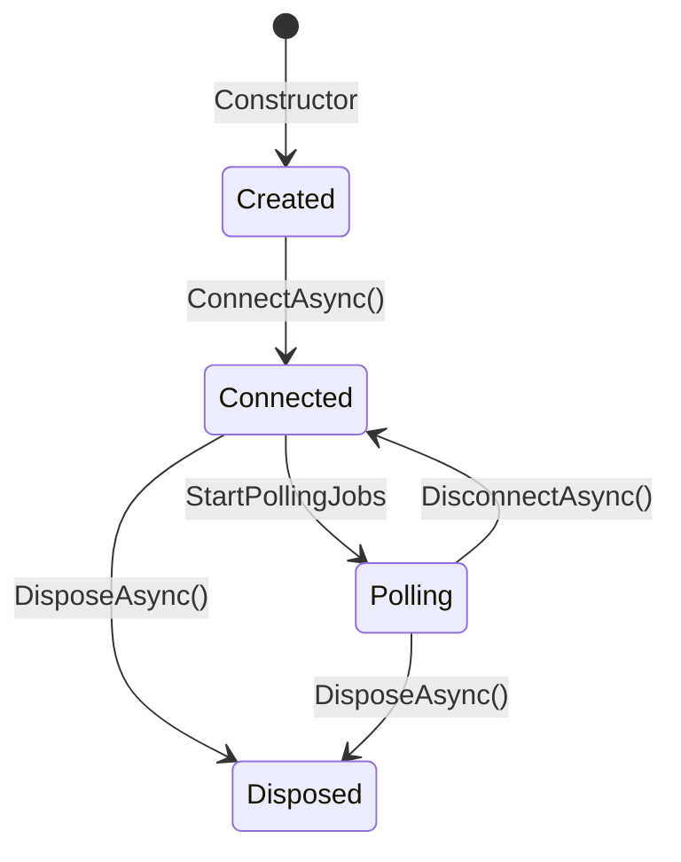
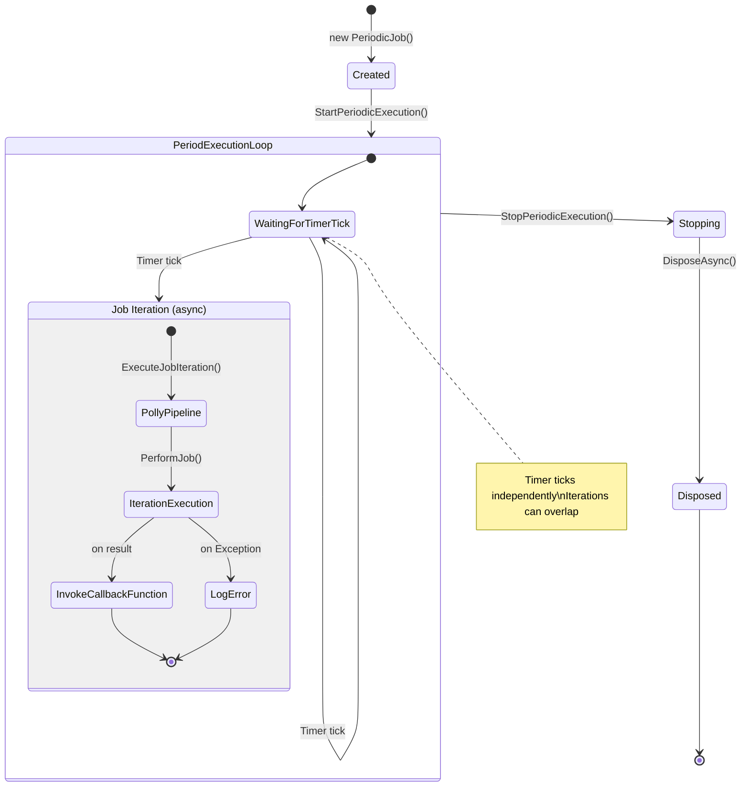

# IncomingDataPortBase

**Namespace**: `ViciOne.Suite.DataPort.Extensions.Incoming`

Base class for implementing incoming (read) data ports. It handles the full lifecycle of connect → verify → poll → publish using the Template Method pattern. You supply the protocol-specific pieces; the base wires them together.

## Data pipeline

```
TCommunication ──► TypedNodeMapper ──► TDeviceNode
                                            │
                                IDataPointGroupsMapper
                                            │
                              ┌─────────────┴─────────────┐
                         TDataPoint[]            TDataPointGroup[]
                                                      │  (one PeriodicJob per group)
                                               IReadClient.ReadAsync()
                                                      │
                                            TDataPointValue[]
                                                      │
                                       IDataPointValueConverter
                                                      │
                                            ExternalValue[]
                                                      │
                                           Received event fired
```

## What you implement vs what the base provides

| Base class handles                          | You implement                                               |
|---------------------------------------------|-------------------------------------------------------------|
| Connection acquire/release sequencing       | `IClientLifecycleManager<TClient>`                               |
| Polling job lifecycle per group             | `IReadClient<TDataPointGroup, TDataPointValue>`             |
| Resilience (timeout + circuit breaker)      | `IDataPointGroupsMapper` (flat list + grouping by frequency)|
| Value publishing via `Received` event       | `CreateReadClient()` — wraps `TClient` in `IReadClient`     |
| Configuration verification on connect      | (Optional) `IDataPointValueConverter` — default is built-in |
| Disposing polling jobs and connections      | (Optional) `IDataPointConfigurationVerifier`                |

## Implementation checklist

Follow these steps in order to build a new incoming data port:

### 1. Define your domain types

You need six concrete types to fill the generic parameters:

| Generic parameter | Your type        | Must implement / extend                                                         |
|-------------------|------------------|---------------------------------------------------------------------------------|
| `TCommunication`  | e.g. `MyConfig`  | `DataPortCommunication` — raw configuration deserialized from YAML              |
| `TDeviceNode`     | e.g. `MyDevice`  | `IRootConfigurationNode<TCommunication>` — strongly-typed config hierarchy root |
| `TDataPoint`      | e.g. `MyPoint`   | `IPollingDataPoint` — has `Identifier`, `Channels`, `PollFrequency`             |
| `TDataPointGroup` | e.g. `MyGroup`   | `IDataPointPollingGroup<TDataPoint>` — groups points sharing a poll frequency   |
| `TDataPointValue` | e.g. `MyValue`   | `IDataPointValue<TDataPoint>` — wraps a read result and its source data point   |
| `TClient`         | e.g. `MyClient`  | Any class — your protocol SDK connection object                                 |

### 2. Implement `IClientLifecycleManager<TClient>`

Responsible for establishing and releasing the protocol connection:

```csharp
public class MyConnectionManager : IClientLifecycleManager<MyClient>
{
    public async Task<MyClient> AcquireConnectedAsync(CancellationToken ct)
    {
        // connect to the device, return connected client
        // throw ConnectionFailureException on failure
    }

    public async Task ReleaseAsync(MyClient client, CancellationToken ct)
    {
        // disconnect / return to pool
    }

    public async ValueTask DisposeAsync() { /* dispose resources */ }
}
```

Throw `ConnectionFailureException` — not protocol-specific exceptions — so the base class and callers have a uniform error surface.

### 3. Implement `IReadClient<TDataPointGroup, TDataPointValue>`

The polling loop calls `ReadAsync` on every timer tick:

```csharp
public class MyReadClient : IReadClient<MyGroup, MyValue>
{
    private readonly MyClient _client;

    public MyReadClient(MyClient client) => _client = client;

    public async ValueTask<IReadOnlyList<MyValue>> ReadAsync(MyGroup group, CancellationToken ct)
    {
        // read all data points in the group from the device
        // translate results to MyValue instances
        // throw ConnectionFailureException if connection is lost
    }

    public void Dispose() { /* release any per-read-session resources */ }
}
```

### 4. Implement `IDataPointGroupsMapper`

Translates a `TDeviceNode` tree into a flat list of data points, then groups them by poll frequency:

```csharp
public class MyDataPointGroupsMapper
    : IDataPointGroupsMapper<MyPoint, MyGroup, MyDevice, MyConfig>
{
    public List<MyPoint> ToDataPoints(MyDevice deviceNode)
    {
        // walk deviceNode hierarchy, produce one MyPoint per addressable item
    }

    public MyGroup CreateGroup(PollFrequency freq, ImmutableList<MyPoint> points)
        => new MyGroup(freq, points);
}
```

The `Group()` method (provided by the interface's default implementation) calls `CreateGroup` per distinct `PollFrequency` found in the list — you only need to implement `ToDataPoints` and `CreateGroup`.

### 5. Override `CreateReadClient`

The one abstract method in the base class. Called once after connection is established to produce the `IReadClient` the polling jobs will use:

```csharp
protected override IReadClient<MyGroup, MyValue> CreateReadClient(MyClient client)
    => new MyReadClient(client);
```

### 6. (Optional) Implement `IDataPointValueConverter`

The interface has a **built-in default implementation** that emits one `ExternalValue` per `TransferredChannel` on each data point, using `dataPointValue.Value` directly. Override only when you need different channel mapping or value transformation:

```csharp
public class MyConverter : IDataPointValueConverter<MyPoint, MyValue>
{
    public IReadOnlyList<ExternalValue> Convert(IReadOnlyList<MyValue> values, DateTime timestamp)
    {
        // produce ExternalValue instances from values
    }
}
```

### 7. (Optional) Implement `IDataPointConfigurationVerifier`

Called during `ConnectAsync` before polling starts. If any data points are misconfigured, the base class disconnects and throws `ConnectionFailureException`. Provide this when you can validate configuration against the live device (e.g., check that a node exists at the expected address):

```csharp
public class MyVerifier : IDataPointConfigurationVerifier<MyPoint>
{
    public async ValueTask<List<MisConfiguredDataPoint<MyPoint>>> Verify(
        List<MyPoint> dataPoints, CancellationToken ct)
    {
        // query device, return misconfigured points (empty list = all OK)
    }
}
```

---

## Putting it together

```csharp
public sealed class MyIncomingDataPort : IncomingDataPortBase<
    MyConfig, MyDevice, MyPoint, MyGroup, MyValue, MyClient>
{
    public MyIncomingDataPort(
        MyConfig communication,
        ILoggerFactory loggerFactory,
        TypedNodeMapper<MyConfig, MyDevice> typedNodeMapper,
        IDataPointGroupsMapper<MyPoint, MyGroup, MyDevice, MyConfig> mapper,
        IClientLifecycleManager<MyClient> connectionManager,
        IDataPointValueConverter<MyPoint, MyValue> converter,
        IDataPointConfigurationVerifier<MyPoint>? verifier = null)
        : base(communication, loggerFactory, typedNodeMapper, mapper,
               connectionManager, converter, verifier)
    { }

    protected override IReadClient<MyGroup, MyValue> CreateReadClient(MyClient client)
        => new MyReadClient(client);
}
```

Wire it in DI and subscribe to `Received` before calling `ConnectAsync`:

```csharp
dataPort.Received += values => /* handle ExternalValues */;
await dataPort.ConnectAsync(cancellationToken);
```

---

## Type parameters

| Parameter         | Constraint                                             | Description                                    |
|-------------------|--------------------------------------------------------|------------------------------------------------|
| `TCommunication`  | `DataPortCommunication`                                | Raw configuration from YAML                    |
| `TDeviceNode`     | `IRootConfigurationNode<TCommunication>`               | Typed configuration hierarchy root             |
| `TDataPoint`      | `IPollingDataPoint`                                    | Addressable data point with poll frequency     |
| `TDataPointGroup` | `IDataPointPollingGroup<TDataPoint>`                   | Set of data points sharing a poll frequency    |
| `TDataPointValue` | `IDataPointValue<TDataPoint>`                          | A read result paired with its source data point|
| `TClient`         | `class`                                                | Protocol SDK connection object                 |

## Lifecycle



1. **Create**: `TypedNodeMapper` and `IDataPointGroupsMapper` run at construction time — configuration errors surface immediately
2. **Connect**: acquires connection, optionally verifies data points, starts one polling job per group
3. **Subscribe**: subscribe to `Received` **before** calling `ConnectAsync` to avoid missing early events
4. **Disconnect**: stops all polling jobs and releases the connection — reconnection is supported
5. **Dispose**: final cleanup; cannot reconnect after disposal

## Constructor parameters

| Parameter                 | Required | Description                                                                                    |
|---------------------------|----------|------------------------------------------------------------------------------------------------|
| `communication`           | Yes      | Configuration used to build `DeviceNode` via `typedNodeMapper`                                 |
| `loggerFactory`           | Yes      | Factory for creating typed loggers                                                             |
| `typedNodeMapper`         | Yes      | Maps `TCommunication` → `TDeviceNode`                                                          |
| `dataPointGroupsMapper`   | Yes      | Maps `TDeviceNode` → `List<TDataPoint>` and groups them into `List<TDataPointGroup>`           |
| `connectionManager`       | Yes      | Manages connection acquisition and release                                                     |
| `dataPointValueConverter` | Yes      | Converts read `TDataPointValue` batches into `ExternalValue` lists                             |
| `configurationVerifier`   | No       | Called during `ConnectAsync` to verify data point configuration against the device             |
| `timeProvider`            | No       | Override for testing; defaults to `TimeProvider.System`                                        |

## Protected members

| Member            | Description                                                            |
|-------------------|------------------------------------------------------------------------|
| `DeviceNode`      | The typed root node derived from the communication configuration       |
| `DataPoints`      | Flat list of all data points                                           |
| `DataPointGroups` | Data points grouped by poll frequency — one polling job runs per group |

## Thread safety

Lifecycle methods (`ConnectAsync`, `DisconnectAsync`, `DisposeAsync`) must be called from a single thread. The `Received` event fires from polling job background threads.

## Polling infrastructure

Each `TDataPointGroup` gets its own `PeriodicJob<TDataPointGroup, List<TDataPointValue>>` instance running on a background timer. The job calls `IReadClient.ReadAsync` on each tick.

**Job lifecycle**:



**`DefaultResiliencePipeline`** wraps each iteration with:

| Strategy              | Setting                                   |
|-----------------------|-------------------------------------------|
| Timeout               | 110% of poll interval, max 30 s           |
| Circuit breaker opens | 50% failure rate over 10 calls            |
| Sampling window       | 10× poll interval, max 5 min              |
| Break duration        | 2× poll interval (500 ms – 2 min) + 50 ms |

**Log event ID ranges** (`PeriodicJobLogMessages`):

| Range     | Category                                      |
|-----------|-----------------------------------------------|
| 1000–1099 | Job lifecycle (starting, stopping, errors)    |
| 1100–1199 | Iteration events                              |
| 1200–1299 | Resilience events (circuit breaker, timeouts) |

---

## Related components

- [IClientLifecycleManager](../Interfaces.md#iconnectionmanager) — connection lifecycle
- [IReadClient](../Interfaces.md#ireadclient) — protocol-agnostic reads
- [IDataPointValueConverter](../Interfaces.md#idatapointvalueconverter) — converting read values to external values
- [IDataPointConfigurationVerifier](../Interfaces.md#idatapointconfigurationverifier) — optional pre-poll validation

---

**Last Updated**: 2026-02-23
