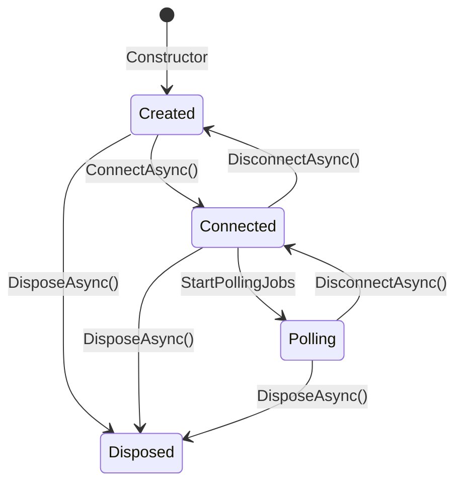

# IncomingDataPortBase

**Namespace**: `ViciOne.Suite.DataPort.Extensions.Incoming`

Base class for implementing incoming (read) data ports using the Template Method pattern.

## Overview

`IncomingDataPortBase` provides a reusable template for building data ports that read data from external devices (e.g., PLCs) and publish it to the DataPort engine. It orchestrates the connection lifecycle, polling job creation, and data transformation while allowing implementations to customize protocol-specific behavior.

## Design Patterns

- **Template Method**: `ConnectAsync`, `StartPollingAndPublishingDataPoints`, `ToExternalValues` orchestrate common flow
- **Strategy**: `IConnectionManager` abstracts connection patterns (pooled vs. direct)
- **Hook Method**: `ValidateAsync` is virtual with a no-op default

## Type Parameters

| Parameter | Description |
|-----------|-------------|
| `TCommunication` | Communication configuration type (extends `DataPortCommunication`) |
| `TDeviceNode` | Device node configuration type (implements `IRootConfigurationNode<TCommunication>`) |
| `TDataPointGroup` | Data point group type for batching reads |
| `TDataPointValue` | Read result type containing the value |
| `TClient` | Client type for read operations |

## Lifecycle



1. **Create**: Instantiate via constructor with device node, data point groups, and dependencies
2. **Connect**: Call `ConnectAsync()` to acquire connection and start polling
3. **Subscribe**: Subscribe to the `Received` event for data updates
4. **Disconnect**: Call `DisconnectAsync()` to stop polling and release connection (supports reconnection)
5. **Dispose**: Call `DisposeAsync()` for final cleanup (cannot reconnect after disposal)

## Abstract Methods to Implement

### CreateReadClient

```csharp
protected abstract IReadClient<TDataPointGroup, TDataPointValue> CreateReadClient(TClient client);
```

Creates a read client adapter from the connected client instance. This adapter implements the `IReadClient` interface for protocol-agnostic reading.

### GetDeviceAddress

```csharp
protected abstract string GetDeviceAddress(TDeviceNode deviceNode);
```

Extracts the device address string for logging purposes. Used in connection/disconnection log messages.

### GetAllDataPoints

```csharp
protected abstract IReadOnlyList<IDataPoint> GetAllDataPoints(IReadOnlyList<TDataPointGroup> dataPointGroups);
```

Flattens all data point groups into a single list of data points for validation. Called during the optional validation phase.

### GetTransferredChannelsCount

```csharp
protected abstract int GetTransferredChannelsCount(TDataPointValue dataPointValue);
```

Returns the number of channels transferred by a single data point value. Used for pre-allocating the external values list capacity.

### AddExternalValuesForDataPoint

```csharp
protected abstract void AddExternalValuesForDataPoint(
    List<ExternalValue> result,
    TDataPointValue dataPointValue,
    DateTime timestamp);
```

Transforms a single data point value into external values with the given timestamp. Add one `ExternalValue` per transferred channel.

### GetPollFrequency

```csharp
protected abstract TimeSpan GetPollFrequency(TDataPointGroup group);
```

Extracts the poll frequency from a data point group. Determines how often the group is polled.

## Virtual Methods (Optional Overrides)

### ValidateAsync

```csharp
protected virtual async ValueTask ValidateAsync(CancellationToken cancellationToken);
```

Optional hook for runtime validation of data points against the device. Default implementation validates using the injected `IDataPointValidator` if provided.

Override this method to implement custom validation logic (e.g., validating symbolic addresses against PLC symbol tables).

## Events

### Received

```csharp
public event Action<IReadOnlyCollection<ExternalValue>>? Received;
```

Fired when new data is polled from the device. Subscribe to this event to receive data updates.

## Implementation Example

```csharp
public sealed class MyIncomingDataPort : IncomingDataPortBase<
    MyCommunication,
    MyDeviceNode,
    MyDataPointGroup,
    MyDataPointValue,
    MyClient>
{
    public MyIncomingDataPort(
        MyDeviceNode deviceNode,
        IReadOnlyList<MyDataPointGroup> dataPointGroups,
        ILoggerFactory loggerFactory,
        IConnectionManager<MyClient> connectionManager)
        : base(
            deviceNode,
            dataPointGroups,
            loggerFactory.CreateLogger<MyIncomingDataPort>(),
            loggerFactory,
            connectionManager)
    {
    }

    protected override IReadClient<MyDataPointGroup, MyDataPointValue> CreateReadClient(MyClient client)
        => new MyReadClientAdapter(client);

    protected override string GetDeviceAddress(MyDeviceNode deviceNode)
        => deviceNode.IpAddress;

    protected override IReadOnlyList<IDataPoint> GetAllDataPoints(
        IReadOnlyList<MyDataPointGroup> dataPointGroups)
    {
        var result = new List<IDataPoint>();
        foreach (var group in dataPointGroups)
            result.AddRange(group.DataPoints);
        return result;
    }

    protected override int GetTransferredChannelsCount(MyDataPointValue dataPointValue)
        => dataPointValue.Channels.Count;

    protected override void AddExternalValuesForDataPoint(
        List<ExternalValue> result,
        MyDataPointValue dataPointValue,
        DateTime timestamp)
    {
        foreach (var channel in dataPointValue.Channels)
        {
            result.Add(new ExternalValue
            {
                Channel = channel,
                Value = dataPointValue.Value,
                Timestamp = timestamp
            });
        }
    }

    protected override TimeSpan GetPollFrequency(MyDataPointGroup group)
        => group.PollInterval;
}
```

## Constructor Parameters

| Parameter | Type | Description |
|-----------|------|-------------|
| `deviceNode` | `TDeviceNode` | Device configuration node |
| `dataPointGroups` | `IReadOnlyList<TDataPointGroup>` | Groups of data points to poll |
| `logger` | `ILogger` | Logger for this instance |
| `loggerFactory` | `ILoggerFactory` | Factory for creating child loggers |
| `connectionManager` | `IConnectionManager<TClient>` | Manages connection acquisition/release |
| `validator` | `IDataPointValidator<IDataPoint>?` | Optional validator for data points |
| `timeProvider` | `TimeProvider?` | Optional time provider for testing |

## Thread Safety

Lifecycle methods (`ConnectAsync`, `DisconnectAsync`, `DisposeAsync`) are not thread-safe and should be called from a single thread. The `Received` event may be raised from polling job threads.

## Related Components

- [IConnectionManager](Interfaces.md#iconnectionmanager) - Connection lifecycle management
- [IReadClient](Interfaces.md#ireadclient) - Protocol-agnostic read operations
- [IDataPointValidator](Interfaces.md#idatapointvalidator) - Optional validation hook
- [PeriodicJob](Overview.md#periodicjob) - Underlying polling mechanism

---

**Last Updated**: 2026-01-30
