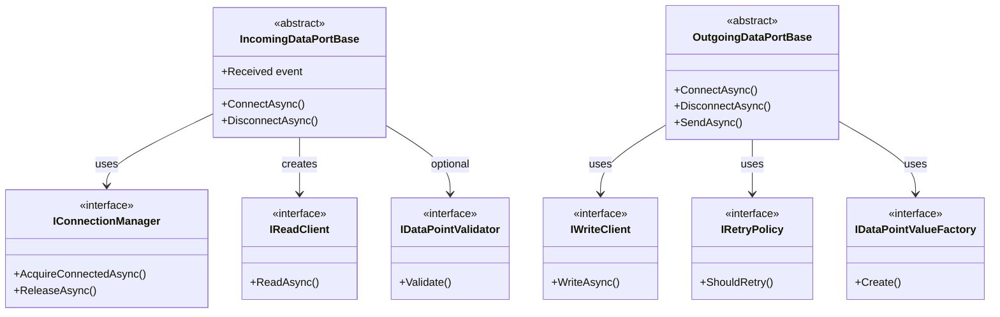

# DataPort Extensions Interfaces

**Namespace**: `ViciOne.Suite.DataPort.Extensions`

Reference documentation for all interfaces in the DataPort Extensions package.

## Overview

These interfaces define the contracts for building protocol-agnostic data ports. They enable separation of concerns between the base class templates and protocol-specific implementations.

## Connection Management

### IConnectionManager

**Namespace**: `ViciOne.Suite.DataPort.Extensions.Incoming`

Manages connection lifecycle for incoming data port clients.

```csharp
public interface IConnectionManager<TClient> : IAsyncDisposable
    where TClient : class
{
    Task<TClient> AcquireConnectedAsync(CancellationToken cancellationToken);
    Task ReleaseAsync(TClient client, CancellationToken cancellationToken);
}
```

**Purpose**: Abstracts connection patterns (pooled vs. direct connections).

**Methods**:

| Method | Description |
|--------|-------------|
| `AcquireConnectedAsync` | Acquires a connected client instance |
| `ReleaseAsync` | Releases the client connection |

**Exceptions**:
- `ConnectionFailureException`: Connection cannot be established
- `OperationCanceledException`: Operation cancelled via token

**Implementation Notes**:
- Pooled connections: Return client to pool on release
- Direct connections: Disconnect and dispose on release

**Example**:
```csharp
public class DirectConnectionManager : IConnectionManager<MyClient>
{
    private readonly string _endpoint;

    public async Task<MyClient> AcquireConnectedAsync(CancellationToken ct)
    {
        var client = new MyClient();
        await client.ConnectAsync(_endpoint, ct);
        return client;
    }

    public async Task ReleaseAsync(MyClient client, CancellationToken ct)
    {
        await client.DisconnectAsync(ct);
        client.Dispose();
    }

    public ValueTask DisposeAsync() => ValueTask.CompletedTask;
}
```

---

## Read Operations

### IReadClient

**Namespace**: `ViciOne.Suite.DataPort.Extensions.Incoming`

Protocol-agnostic client for reading data points from a device.

```csharp
public interface IReadClient<in TDataPointGroup, TDataPointValue> : IDisposable
{
    ValueTask<IReadOnlyList<TDataPointValue>> ReadAsync(
        TDataPointGroup dataPointGroup,
        CancellationToken cancellationToken);
}
```

**Purpose**: Abstracts protocol-specific read operations for use by `IncomingDataPortBase`.

**Type Parameters**:
| Parameter | Description |
|-----------|-------------|
| `TDataPointGroup` | Data point group type (batch of related data points) |
| `TDataPointValue` | Read result type containing the value(s) |

**Exceptions**:
- `ConnectionFailureException`: Connection lost during read
- `OperationCanceledException`: Operation cancelled via token

**Implementation Notes**:
- Translate protocol-specific errors to common exceptions
- Return all values for the group in a single call
- Handle batch reads efficiently

---

### IDataPointValidator

**Namespace**: `ViciOne.Suite.DataPort.Extensions.Incoming`

Optional validator for data points against device configuration.

```csharp
public interface IDataPointValidator<TDataPoint>
    where TDataPoint : IDataPoint
{
    void Validate<TClient>(
        TClient client,
        IReadOnlyList<TDataPoint> dataPoints,
        ILogger logger)
        where TClient : class;
}
```

**Purpose**: Optional hook for runtime validation (e.g., validating symbolic addresses against PLC symbol tables).

**Exceptions**:
- `ConnectionFailureException`: Validation fails (e.g., symbol not found)

**Default Implementation**: `NoOpDataPointValidator<TDataPoint>` - does nothing.

**Example**:
```csharp
public class SymbolValidator : IDataPointValidator<SymbolicDataPoint>
{
    public void Validate<TClient>(TClient client, IReadOnlyList<SymbolicDataPoint> dataPoints, ILogger logger)
        where TClient : class
    {
        var symbolClient = (ISymbolClient)client;
        foreach (var dp in dataPoints)
        {
            if (!symbolClient.SymbolExists(dp.SymbolName))
                throw new ConnectionFailureException($"Symbol not found: {dp.SymbolName}");
        }
    }
}
```

---

## Write Operations

### IWriteClient

**Namespace**: `ViciOne.Suite.DataPort.Extensions.Outgoing`

Protocol-agnostic client for writing data point values to a device.

```csharp
public interface IWriteClient<TDataPointValue>
{
    ValueTask WriteAsync(IReadOnlyList<TDataPointValue> values, CancellationToken cancellationToken);
}
```

**Purpose**: Abstracts protocol-specific write operations for use by `OutgoingDataPortBase`.

**Implementation Notes**:
- Write all values in a single batch operation
- Throw on failure (retry logic is handled by the base class)
- Use `CancellationToken.None` during retries to avoid cancelling mid-write

---

### IRetryPolicy

**Namespace**: `ViciOne.Suite.DataPort.Extensions.Outgoing`

Defines retry behavior for failed write operations.

```csharp
public interface IRetryPolicy
{
    bool ShouldRetry(long retryCount);
    void OnMaxRetriesExceeded(long retryCount, Exception exception);
}
```

**Purpose**: Abstracts retry decision logic for write failures.

**Methods**:
| Method | Description |
|--------|-------------|
| `ShouldRetry` | Returns true if another retry should be attempted |
| `OnMaxRetriesExceeded` | Called when retries are exhausted (for logging) |

**Built-in Implementations**:

#### BoundedRetryPolicy

Retries up to a configured maximum number of attempts.

```csharp
public sealed class BoundedRetryPolicy(long maxRetryAttempts, ILogger? logger = null) : IRetryPolicy
```

Use when: You want to give up after a reasonable number of attempts.

#### InfiniteRetryPolicy

Never gives up retrying.

```csharp
public sealed class InfiniteRetryPolicy : IRetryPolicy
```

Use when: Writes are expected to eventually succeed (e.g., transient network issues).

---

### IDataPointValueFactory

**Namespace**: `ViciOne.Suite.DataPort.Extensions.Outgoing`

Factory for creating data point values from external values.

```csharp
public interface IDataPointValueFactory<in TDataPoint, out TDataPointValue>
{
    TDataPointValue Create(TDataPoint dataPoint, object? value);
}
```

**Purpose**: Transforms incoming `ExternalValue` objects into protocol-specific data point values.

**Implementation Notes**:
- Map the runtime value to the appropriate protocol type
- The created value will be validated by `DataPointValueValidator`

**Example**:
```csharp
public class MyValueFactory : IDataPointValueFactory<MyDataPoint, MyDataPointValue>
{
    public MyDataPointValue Create(MyDataPoint dataPoint, object? value)
    {
        return new MyDataPointValue
        {
            DataPoint = dataPoint,
            Value = value
        };
    }
}
```

---

## Data Point Interfaces

### IDataPoint

**Namespace**: `ViciOne.Suite.DataPort.Extension.Model.DataPoints`

Base interface for all data point configurations.

```csharp
public interface IDataPoint
{
    Channels Channels { get; }
    string AddressString { get; }
    string DataTypeString { get; }
}
```

See [Model.md](Model.md) for details.

---

### IDataPointValue

**Namespace**: `ViciOne.Suite.DataPort.Extension.Model.DataPoints`

Interface for data point values used in write operations.

```csharp
public interface IDataPointValue<TDataPointType> where TDataPointType : IDataPoint
{
    object? Value { get; init; }
    TDataPointType DataPoint { get; init; }

    bool IsInValueRange();
    TypeValidationResult ValidateType();
}
```

**Purpose**: Represents a value to be written, with validation capabilities.

**Methods**:
| Method | Description |
|--------|-------------|
| `IsInValueRange` | Returns true if the value is within valid bounds |
| `ValidateType` | Validates that the value type matches the data point type |

See [ValueValidation.md](ValueValidation.md) for validation details.

---

## Interface Relationships



---

**Last Updated**: 2026-01-30
