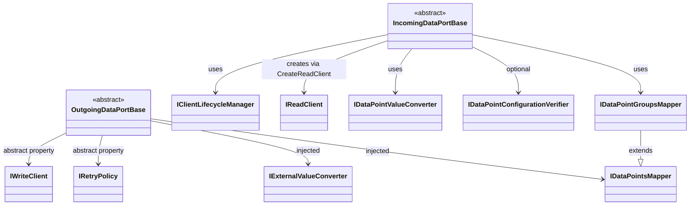

# DataPort Extensions Interfaces

**Namespace**: `ViciOne.Suite.DataPort.Extensions`

Reference for all interfaces in the DataPort Extensions package.

## Connection Management

### IClientLifecycleManager

**Namespace**: `ViciOne.Suite.DataPort.Extensions.Incoming.Client`

Manages connection lifecycle for incoming data ports. Abstracts whether connections are pooled or created fresh per acquisition.

**Methods**: `AcquireConnectedAsync(CancellationToken)` → returns a connected client; `ReleaseAsync(TClient, CancellationToken)` → returns or disposes the client.

**Exceptions to throw from implementations**:
- `ConnectionFailureException`: when a connection cannot be established

**Implementation notes**:
- Pooled connections: return the client to the pool on release
- Direct connections: disconnect and dispose on release

---

## Read Operations

### IReadClient

**Namespace**: `ViciOne.Suite.DataPort.Extensions.Incoming.Client`

Protocol-agnostic client for reading a group of data points in a single call. Translate protocol-specific errors to `DataRetrievalException` or `ConnectionFailureException`.

---

### IDataPointValueConverter

**Namespace**: `ViciOne.Suite.DataPort.Extensions.Incoming.ValueConversion`

Converts a batch of `TDataPointValue` instances (as read from the device) into a flat list of `ExternalValue` instances published via the `Received` event.

The interface has a **default implementation** that produces one `ExternalValue` per `TransferredChannel` on each data point's `Channels`, using the data point value's `Value` and setting `Validity = 1`. Override only if you need custom per-channel value mapping or transformation.

---

### IDataPointConfigurationVerifier

**Namespace**: `ViciOne.Suite.DataPort.Extensions.Incoming.Verification`

Optional hook for verifying data point configuration against the live device before polling starts (e.g., checking that symbolic addresses exist in the PLC symbol table).

Return a list of `MisConfiguredDataPoint<TDataPoint>` records for any data points that failed verification; return an empty list if all are valid. `IncomingDataPortBase` logs each mismatch and aborts `ConnectAsync` if any failures are found.

`MisConfiguredDataPoint<TDataPoint>` holds the data point and a `List<MisMatchingConfiguration>` with human-readable mismatch descriptions.

---

## Write Operations

### IWriteClient

**Namespace**: `ViciOne.Suite.DataPort.Extensions.Outgoing.Client`

Protocol-agnostic client for writing a batch of data point values in a single call.

**Implementation notes**:
- Write all values atomically if the protocol supports it
- Throw on any failure — retry is handled by the base class
- Do not use the `CancellationToken` during retries to avoid aborting a mid-flight write

---

### IExternalValueConverter

**Namespace**: `ViciOne.Suite.DataPort.Extensions.Outgoing.Value.Conversion`

Converts a single `ExternalValue` (already resolved to a specific `TDataPoint` by `ChannelResolver`) into a `TDataPointValue` for writing. Called once per resolved channel before validation.

```csharp
TDataPointValue Convert(ExternalValue externalValue, TDataPoint dataPoint);
```

---

### IRetryPolicy

**Namespace**: `ViciOne.Suite.DataPort.Extensions.Outgoing.QueueProcessing.Retry`

Controls retry behaviour for failed write operations.

**Methods**: `ShouldRetry(long retryCount)` → return `true` to retry; `OnMaxRetriesExceeded(long retryCount, Exception exception)` → called when retries are exhausted (for logging or throwing).

**Built-in implementations**:

| Class | Behaviour |
|-------|-----------|
| `BoundedRetryPolicy(long maxRetryAttempts)` | Stops after `maxRetryAttempts` attempts |
| `InfiniteRetryPolicy` | Retries indefinitely |

---

## Mapping Interfaces

**Namespace**: `ViciOne.Suite.DataPort.Extensions.Model.Mapping`

### IDataPointsMapper

Maps a typed root configuration node into a flat list of data points. Used by `OutgoingDataPortBase` and as the base for `IDataPointGroupsMapper`.

Has three generic type parameters: `TDataPoint`, `TRootNode`, `TDataPortCommunication`. Implement `ToDataPoints(TRootNode deviceNode) → List<TDataPoint>`.

### IDataPointGroupsMapper

Extends `IDataPointsMapper` with grouping for incoming data ports. Has four generic type parameters: `TDataPoint`, `TDataPointGroup`, `TRootNode`, `TDataPortCommunication`.

**Only `CreateGroup(PollFrequency, ImmutableList<TDataPoint>)` requires implementation** — default methods handle the grouping logic (`Group` groups by `PollFrequency`, `ToDataPointGroups` calls both).

---

## Data Point Interfaces

### IDataPoint

**Namespace**: `ViciOne.Suite.DataPort.Extensions.Model.DataPoints`

Base interface for all data point configurations.

**Members**:
- `Channels Channels { get; init; }` — channel routing configuration
- `DataPointIdentifier Identifier { get; }` — strongly-typed address wrapper (protocol-specific format; used for logging)
- `DataTypeName DataTypeName { get; }` — strongly-typed data type name wrapper (protocol-specific; used for logging)
- `ContainsTransferredChannel(string channel)` — default implementation; checks `Channels.TransferredChannels`

`DataPointIdentifier` and `DataTypeName` are records with a single `string Value` property, defined in the same file as `IDataPoint`.

---

### IDataPointValue

**Namespace**: `ViciOne.Suite.DataPort.Extensions.Model.DataPoints`

Represents a value to be written, with validation capabilities. Required by `DataPointValueValidator`.

**Members**: `Value`, `DataPoint`, `IsInValueRange()`, `ValidateType()`. See [ValueValidation.md](Outgoing/ValueValidation.md).

---

## Interface Relationships



---

**Last Updated**: 2026-02-20
