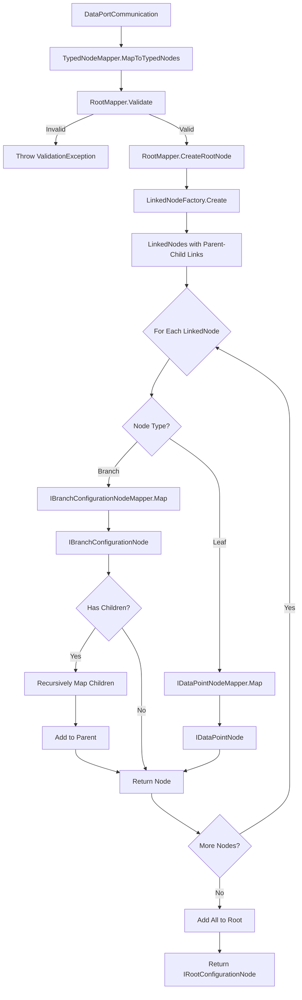

# Model Components

**Namespace**: `ViciOne.Suite.DataPort.Extensions.Model`

**Location**: `src/DataPort.Extensions/Model/`

Defines core abstractions and value types for DataPort operations.

## Data Point Abstractions

### IDataPoint

**Location**: `Model/DataPoints/IDataPoint.cs`

Base interface for all data point types.

**Members**:
- `Channels Channels { get; init; }` — channel routing (transferred and affected channels)
- `DataPointIdentifier Identifier { get; }` — strongly-typed address wrapper (used for logging/diagnostics; format is protocol-specific)
- `DataTypeName DataTypeName { get; }` — strongly-typed data type name wrapper (used for logging/diagnostics; format is protocol-specific)
- `ContainsTransferredChannel(string channel)` — default implementation; checks `Channels.TransferredChannels`

`DataPointIdentifier` and `DataTypeName` are record types with a single `string Value` property, defined in the same file.

### IPollingDataPoint

**Location**: `Model/DataPoints/IPollingDataPoint.cs`

Extends `IDataPoint` with `PollFrequency PollFrequency { get; init; }`. Required for data points used with `IncomingDataPortBase`.

### IDataPointPollingGroup

**Location**: `Model/DataPoints/IDataPointPollingGroup.cs`

Generic interface (`IDataPointPollingGroup<TDataPoint>`) grouping data points that share the same poll frequency. One polling job runs per group. Holds `PollFrequency` and `ImmutableList<TDataPoint>`.

### IDataPointValue

**Location**: `Model/DataPoints/IDataPointValue.cs`

Value to be written, with type and range validation. See [ValueValidation.md](Outgoing/ValueValidation.md).

## Value Types

### Channels

**Location**: `Model/DataPoints/Channels.cs`

```csharp
public record Channels(
    ImmutableList<AffectedChannel> AffectedChannels,
    ImmutableList<TransferredChannel> TransferredChannels);
```

- `TransferredChannels`: channels actively publishing/receiving data values
- `AffectedChannels`: channels associated with the data point but not directly transferring data

Both `AffectedChannel` and `TransferredChannel` are records wrapping a single `string Value`.

### PollFrequency

**Location**: `Model/DataPoints/PollFrequency.cs`

Strongly-typed polling interval wrapping a `TimeSpan`. Has implicit conversions to/from `TimeSpan`.

```csharp
var fast   = new PollFrequency(TimeSpan.FromMilliseconds(100));  // 10 Hz
var medium = new PollFrequency(TimeSpan.FromMilliseconds(500));  // 2 Hz
var slow   = new PollFrequency(TimeSpan.FromSeconds(1));         // 1 Hz
```

## Configuration Records

### QueueConfiguration

**Location**: `Outgoing/QueueProcessing/QueueConfiguration.cs`

```csharp
public record QueueConfiguration(QueueStrategy Strategy, QueueSize QueueSize);
public record QueueSize(int Value);
```

`QueueStrategy` is an enum: `DropOldest` or `DropNewest`. See [Queue.md](Outgoing/Queue.md) for selection guidance.

## Mapping

**Location**: `Model/Mapping/`

`IDataPointsMapper` and `IDataPointGroupsMapper` — see [Interfaces.md](Interfaces.md#mapping-interfaces).

## TypedNodes

**Location**: `Model/TypedNodes/`

**Namespace**: `ViciOne.Suite.DataPort.Extensions.Model.TypedNodes`

`TypedNodeMapper<TCommunication, TRootNode>` transforms a `DataPortCommunication` object into a validated typed node hierarchy. See [Overview.md](Overview.md) for the conceptual overview.

### Mapping Process

1. Validates configuration using FluentValidation
2. Creates the root typed node via `RootMapper.CreateRootNode`
3. Converts raw nodes to `LinkedNode`s (establishes parent-child relationships)
4. For each `LinkedNode`, finds the registered `IBranchConfigurationNodeMapper` or `IDataPointNodeMapper` and maps it to a typed node
5. Assembles the full hierarchy and returns the root



### Node Interfaces

| Interface | Location | Role |
|-----------|----------|------|
| `IRootConfigurationNode<TCommunication>` | `TypedNodes/IRootConfigurationNode.cs` | Root of the tree |
| `IBranchConfigurationNode` | `TypedNodes/IBranchConfigurationNode.cs` | Interior grouping node |
| `IDataPointNode` | `TypedNodes/IDataPointNode.cs` | Leaf node; becomes a `TDataPoint` |

---

**Last Updated**: 2026-02-23
