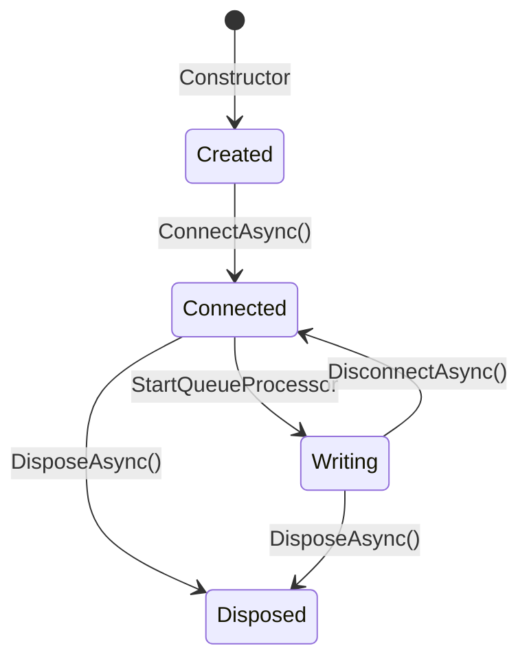

# OutgoingDataPortBase

**Namespace**: `ViciOne.Suite.DataPort.Extensions.Outgoing`

Base class for implementing outgoing (write) data ports. It handles the full pipeline of connect → resolve channels → convert → validate → enqueue → write with retry using the Template Method pattern. You supply the protocol-specific pieces; the base wires them together.

## Data pipeline

```
TCommunication ──► TypedNodeMapper ──► TRootNode
                                           │
                                   IDataPointsMapper
                                           │
                                    TDataPoint[]
                                           │
                              (at SendAsync time)
                                           │
                                   ExternalValue[]
                                           │
                                    ChannelResolver (O(1))
                                           │
                          ┌────────────────┴──────────────────┐
                   ResolvedChannel[]              UnresolvedChannel[]
                          │                        (logged, skipped)
                  IExternalValueConverter
                          │
                    TDataPointValue[]
                          │
                  DataPointValueValidator
                          │
               ┌──────────┴────────────┐
           valid                   invalid
               │                   (entire batch dropped + logged)
          QueueProcessor
               │
      IWriteClient.WriteAsync()
            + IRetryPolicy
```

## What you implement vs what the base provides

| Base class handles                                  | You implement                                                      |
|-----------------------------------------------------|--------------------------------------------------------------------|
| Channel-to-data-point resolution (O(1))             | `AcquireConnectionAsync()` — connect and return the client         |
| Value conversion per resolved channel               | `ValidateConnectionAsync()` — verify the live connection           |
| All-or-nothing batch validation                     | `ReleaseConnectionAsync()` — disconnect and clean up               |
| Background queue processing with peek/mark retry    | `RetryPolicy` abstract property — `BoundedRetryPolicy` or `InfiniteRetryPolicy` |
| Exponential backoff between write retries           | `WriteClient` abstract property — your `IWriteClient<TDataPointValue>` |
| Backpressure detection during retry                 | `IDataPointsMapper` (injected) — maps `TRootNode` → `List<TDataPoint>`|
| Disposing the queue processor                       | `IExternalValueConverter` (injected) — `ExternalValue` → `TDataPointValue` |

## Implementation checklist

Follow these steps in order to build a new outgoing data port:

### 1. Define your domain types

You need five concrete types to fill the generic parameters:

| Generic parameter | Your type        | Must implement / extend                                                         |
|-------------------|------------------|---------------------------------------------------------------------------------|
| `TCommunication`  | e.g. `MyConfig`  | `DataPortCommunication` — raw configuration deserialized from YAML              |
| `TRootNode`       | e.g. `MyDevice`  | `IRootConfigurationNode<TCommunication>` — strongly-typed config hierarchy root |
| `TDataPoint`      | e.g. `MyPoint`   | `IDataPoint` — has `Channels`, `Identifier`, `DataTypeName`                     |
| `TDataPointValue` | e.g. `MyValue`   | `IDataPointValue<TDataPoint>` — wraps a write value with type/range validation  |
| `TClient`         | e.g. `MyClient`  | Any class — your protocol SDK connection object                                 |

### 2. Implement `IDataPointsMapper`

Translates a `TRootNode` tree into a flat list of data points at construction time:

```csharp
public class MyDataPointsMapper
    : IDataPointsMapper<MyPoint, MyDevice, MyConfig>
{
    public List<MyPoint> ToDataPoints(MyDevice rootNode)
    {
        // walk rootNode hierarchy, produce one MyPoint per writable address
    }
}
```

### 3. Implement `IExternalValueConverter`

Called once per resolved channel in `SendAsync` to produce the write value:

```csharp
public class MyValueConverter : IExternalValueConverter<MyPoint, MyValue>
{
    public MyValue Convert(ExternalValue externalValue, MyPoint dataPoint)
    {
        // translate the ExternalValue's raw value to MyValue
        // throw DataConversionException on conversion failure
    }
}
```

### 4. Implement `IWriteClient`

Called by the queue processor for each batch dequeued for writing:

```csharp
public class MyWriteClient : IWriteClient<MyValue>
{
    private readonly MyClient _client;

    public MyWriteClient(MyClient client) => _client = client;

    public async ValueTask WriteAsync(IReadOnlyList<MyValue> values, CancellationToken ct)
    {
        // write all values to the device in a single call where possible
        // throw on any failure — the base class handles retry
    }
}
```

### 5. Override abstract members

Three abstract connection methods and two abstract properties must be provided:

```csharp
private MyClient? _client;

protected override async Task<MyClient> AcquireConnectionAsync(CancellationToken ct)
{
    _client = new MyClient();
    await _client.ConnectAsync(ct);
    return _client;
    // throw ConnectionFailureException on failure
}

protected override Task ValidateConnectionAsync(CancellationToken ct)
{
    if (_client?.IsConnected != true)
        throw new ConnectionFailureException("Not connected");
    return Task.CompletedTask;
}

protected override async Task ReleaseConnectionAsync(CancellationToken ct)
{
    if (_client is null) return;
    await _client.DisconnectAsync(ct);
    _client = null;
}

protected override IRetryPolicy RetryPolicy { get; } = new BoundedRetryPolicy(maxRetryAttempts: 5);

protected override IWriteClient<MyValue> WriteClient => new MyWriteClient(_client!);
```

Throw `ConnectionFailureException` — not protocol-specific exceptions — so callers have a uniform error surface.

### 6. (Optional) Override `DisposeClient`

Called by `DisposeAsync` after the queue processor has stopped. Override when your client holds unmanaged resources that are not released in `ReleaseConnectionAsync`:

```csharp
protected override void DisposeClient()
{
    _client?.Dispose();
}
```

---

## Putting it together

```csharp
public sealed class MyOutgoingDataPort : OutgoingDataPortBase<
    MyPoint, MyValue, MyClient, MyDevice, MyConfig>
{
    private MyClient? _client;

    public MyOutgoingDataPort(
        MyConfig communication,
        TypedNodeMapper<MyConfig, MyDevice> typedNodeMapper,
        IDataPointsMapper<MyPoint, MyDevice, MyConfig> mapper,
        IExternalValueConverter<MyPoint, MyValue> valueConverter,
        QueueConfiguration queueConfiguration,
        ILoggerFactory loggerFactory)
        : base(communication, typedNodeMapper, mapper, valueConverter, queueConfiguration, loggerFactory)
    { }

    protected override IRetryPolicy RetryPolicy { get; } = new BoundedRetryPolicy(maxRetryAttempts: 5);
    protected override IWriteClient<MyValue> WriteClient => new MyWriteClient(_client!);

    protected override async Task<MyClient> AcquireConnectionAsync(CancellationToken ct)
    {
        _client = new MyClient();
        await _client.ConnectAsync(ct);
        return _client;
    }

    protected override Task ValidateConnectionAsync(CancellationToken ct)
    {
        if (_client?.IsConnected != true)
            throw new ConnectionFailureException("Not connected");
        return Task.CompletedTask;
    }

    protected override async Task ReleaseConnectionAsync(CancellationToken ct)
    {
        if (_client is null) return;
        await _client.DisconnectAsync(ct);
        _client = null;
    }
}
```

Wire it in DI and call `ConnectAsync` before writing:

```csharp
await dataPort.ConnectAsync(cancellationToken);
await dataPort.SendAsync(engineCycle, externalValues, cancellationToken);
```

---

## Type parameters

| Parameter         | Constraint                                      | Description                                    |
|-------------------|-------------------------------------------------|------------------------------------------------|
| `TDataPoint`      | `class, IDataPoint`                             | Addressable data point with channel metadata   |
| `TDataPointValue` | `IDataPointValue<TDataPoint>`                   | A write value paired with its data point       |
| `TClient`         | `class`                                         | Protocol SDK connection object                 |
| `TRootNode`       | `IRootConfigurationNode<TCommunication>`        | Typed configuration hierarchy root             |
| `TCommunication`  | `DataPortCommunication`                         | Raw configuration from YAML                    |

## Lifecycle



1. **Create**: `TypedNodeMapper` and `IDataPointsMapper` run at construction time — configuration errors surface immediately
2. **Connect**: acquires connection, validates it, starts the background queue processor
3. **Send**: `SendAsync` resolves channels, converts values, validates the batch, and enqueues
4. **Disconnect**: stops the queue processor and releases the connection — reconnection is supported
5. **Dispose**: final cleanup; disposes the queue processor and calls `DisposeClient`

## Constructor parameters

| Parameter            | Required | Description                                                                          |
|----------------------|----------|--------------------------------------------------------------------------------------|
| `communication`      | Yes      | Configuration used to build `RootNode` via `typedNodeMapper`                         |
| `typedNodeMapper`    | Yes      | Maps `TCommunication` → `TRootNode`                                                  |
| `mapper`             | Yes      | Maps `TRootNode` → `List<TDataPoint>`                                                |
| `valueConverter`     | Yes      | Converts a resolved `ExternalValue` + matched `TDataPoint` → `TDataPointValue`       |
| `queueConfiguration` | Yes      | Queue capacity (`QueueSize`) and overflow strategy (`QueueStrategy`)                 |
| `loggerFactory`      | Yes      | Factory for creating typed loggers                                                   |
| `delayProvider`      | No       | Override in tests to skip retry backoff waits; defaults to `Task.Delay`              |

## Protected members

| Member      | Description                                              |
|-------------|----------------------------------------------------------|
| `RootNode`  | The typed root node derived from the communication configuration |
| `DataPoints`| Flat list of all data points mapped from `RootNode`      |
| `Logger`    | Typed logger instance; use in subclasses for structured logging |

## Thread safety

Lifecycle methods (`ConnectAsync`, `DisconnectAsync`, `SendAsync`, `DisposeAsync`) must be called from a single thread. The queue processor runs on a background thread but all public entry points are single-threaded.

## Queue infrastructure

The `QueueProcessor` is an internal background loop that dequeues and writes batches using a **peek/mark pattern**: it peeks the head item before writing and only marks it as read on success. This allows retry without re-enqueue.

**Write retry**:

| Setting     | Behaviour                                                           |
|-------------|---------------------------------------------------------------------|
| Policy      | `IRetryPolicy.ShouldRetry(retryCount)` checked before each attempt |
| Backoff     | Exponential: `min(200ms × 2^(n-1), 1000ms)`                        |
| Logging     | Debug for attempts 1–4; Warning at attempt 5 and every 10th after  |
| On exhaustion | `MaxRetriesExceededException` caught, item dropped, loop continues |

**Backpressure handling** (`DropOldest` strategy):

If the queue overflows while a retry is in progress, the item at the head may change. The processor detects this and abandons the current retry, letting the fresher item be processed next. A `QueueBackpressureException` is caught internally and the item is discarded.

**`QueueConfiguration`**:

| Property      | Description                                                              |
|---------------|--------------------------------------------------------------------------|
| `QueueSize`   | Maximum number of batches the queue can hold                             |
| `QueueStrategy.DropOldest` | Drop the oldest batch when full — prioritises freshness    |
| `QueueStrategy.DropNewest` | Reject the incoming batch when full — preserves queue order|

---

## Related components

- [IWriteClient](../Interfaces.md#iwriteclient) — protocol-agnostic write operations
- [IExternalValueConverter](../Interfaces.md#iexternalvalueconverter) — value conversion
- [IRetryPolicy](../Interfaces.md#iretrypolicy) — retry decision logic
- [ValueValidation](ValueValidation.md) — validation system
- [Queue](Queue.md) — underlying queue implementation

---

**Last Updated**: 2026-02-23
