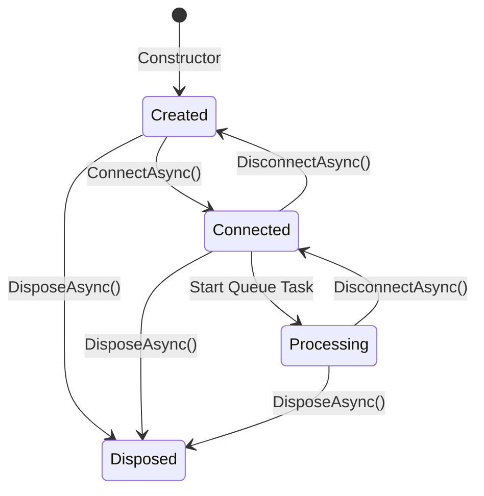
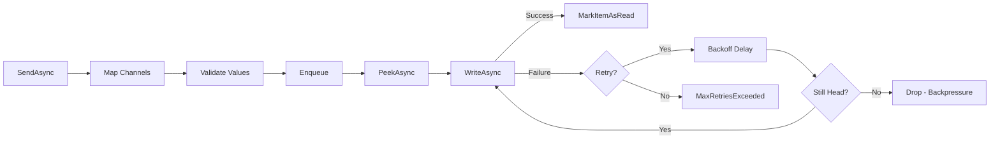

# OutgoingDataPortBase

**Namespace**: `ViciOne.Suite.DataPort.Extensions.Outgoing`

Base class for implementing outgoing (write) data ports using the Template Method pattern.

## Overview

`OutgoingDataPortBase` provides a reusable template for building data ports that write data to external devices (e.g., PLCs). It orchestrates the connection lifecycle, queue-based write processing, value validation, and retry logic while allowing implementations to customize protocol-specific behavior.

## Design Patterns

- **Template Method**: `ConnectAsync`, `DisconnectAsync`, `ProcessQueueAsync` orchestrate common flow
- **Strategy**: `IRetryPolicy`, `IWriteClient`, `IDataPointValueFactory` abstract implementation-specific behavior
- **Factory**: `IDataPointValueFactory` creates validated data point values from external values

## Type Parameters

| Parameter | Description |
|-----------|-------------|
| `TDataPoint` | Data point configuration type (implements `IDataPoint`) |
| `TDataPointValue` | Write value type (implements `IDataPointValue<TDataPoint>`) |
| `TClient` | Connection client type for lifecycle management |

## Lifecycle



1. **Create**: Instantiate via constructor with data points and dependencies
2. **Connect**: Call `ConnectAsync()` to acquire connection and start queue processing
3. **Send**: Call `SendAsync()` to enqueue values for writing
4. **Disconnect**: Call `DisconnectAsync()` to stop processing and release connection
5. **Dispose**: Call `DisposeAsync()` for final cleanup

## Queue Processing Pipeline



### Value Validation (Two-Phase, All-or-Nothing)

1. **Phase 1 - Mapping**: Map external values to data points using channel lookup
   - Unmapped channels are collected and the entire batch is rejected if any exist
2. **Phase 2 - Validation**: Validate all mapped values for type and range
   - Type mismatches and out-of-range values are collected
   - If any validation fails, the entire batch is rejected

This prevents partial writes that could leave the device in an inconsistent state.

### Backpressure Detection

During retry, the system checks if the item being processed is still at the head of the queue. If a newer item has superseded it (due to DropOldest strategy), the current item is abandoned to process fresher data.

## Abstract Properties to Implement

### RetryPolicy

```csharp
protected abstract IRetryPolicy RetryPolicy { get; }
```

Defines retry behavior for failed write operations. Choose from:
- `BoundedRetryPolicy`: Retry up to a maximum number of attempts
- `InfiniteRetryPolicy`: Retry indefinitely (use when writes are expected to eventually succeed)

### WriteClient

```csharp
protected abstract IWriteClient<TDataPointValue> WriteClient { get; }
```

Protocol-agnostic client for writing data point values to the device.

### ValueFactory

```csharp
protected abstract IDataPointValueFactory<TDataPoint, TDataPointValue> ValueFactory { get; }
```

Factory for creating validated data point values from external values.

## Abstract Methods to Implement

### AcquireConnectionAsync

```csharp
protected abstract Task<TClient> AcquireConnectionAsync(CancellationToken cancellationToken);
```

Acquires a connected client instance. Called during `ConnectAsync()`.

### ReleaseConnectionAsync

```csharp
protected abstract Task ReleaseConnectionAsync(CancellationToken cancellationToken);
```

Releases the connection and performs cleanup. Called during `DisconnectAsync()`.

### ValidateConnectionAsync

```csharp
protected abstract Task ValidateConnectionAsync(CancellationToken cancellationToken);
```

Validates the connection after acquisition. Called during `ConnectAsync()` after `AcquireConnectionAsync()`.

## Virtual Methods (Optional Overrides)

### DisposeClient

```csharp
protected virtual void DisposeClient() { }
```

Optional hook for disposing client-specific resources during `DisposeAsync()`.

## Public Methods

### SendAsync

```csharp
public Task SendAsync(IReadOnlyCollection<ExternalValue> values);
```

Sends external values to the device via the queue. Values are mapped, validated, and enqueued for processing.

## Implementation Example

```csharp
public sealed class MyOutgoingDataPort : OutgoingDataPortBase<
    MyDataPoint,
    MyDataPointValue,
    MyClient>
{
    private readonly IWriteClient<MyDataPointValue> _writeClient;
    private MyClient? _client;

    public MyOutgoingDataPort(
        IReadOnlyList<MyDataPoint> dataPoints,
        IWriteClient<MyDataPointValue> writeClient,
        ILogger<MyOutgoingDataPort> logger)
        : base(
            dataPoints: dataPoints,
            channelSelector: dp => dp.Channels.ToList(),
            queueCapacity: 1000,
            overflowStrategy: QueueStrategy.DropOldest,
            logger: logger)
    {
        _writeClient = writeClient;
    }

    protected override IRetryPolicy RetryPolicy { get; } = new BoundedRetryPolicy(maxRetryAttempts: 5);

    protected override IWriteClient<MyDataPointValue> WriteClient => _writeClient;

    protected override IDataPointValueFactory<MyDataPoint, MyDataPointValue> ValueFactory { get; }
        = new MyValueFactory();

    protected override async Task<MyClient> AcquireConnectionAsync(CancellationToken cancellationToken)
    {
        _client = new MyClient();
        await _client.ConnectAsync(cancellationToken);
        return _client;
    }

    protected override async Task ReleaseConnectionAsync(CancellationToken cancellationToken)
    {
        if (_client != null)
        {
            await _client.DisconnectAsync(cancellationToken);
            _client = null;
        }
    }

    protected override Task ValidateConnectionAsync(CancellationToken cancellationToken)
    {
        if (_client?.IsConnected != true)
            throw new InvalidOperationException("Not connected");
        return Task.CompletedTask;
    }
}
```

## Constructor Parameters

| Parameter | Type | Description |
|-----------|------|-------------|
| `dataPoints` | `IReadOnlyList<TDataPoint>` | Collection of data point configurations |
| `channelSelector` | `Func<TDataPoint, IReadOnlyList<string>>` | Function to extract channels from a data point |
| `queueCapacity` | `int` | Maximum queue capacity |
| `overflowStrategy` | `QueueStrategy` | Strategy for handling queue overflow |
| `logger` | `ILogger` | Logger instance |
| `delayProvider` | `IDelayProvider?` | Optional delay provider for testing |
| `timeProvider` | `TimeProvider?` | Optional time provider for testing |

## Performance Optimizations

- **O(1) Channel Lookup**: Uses a pre-built dictionary for channel-to-data-point mapping
- **Pre-allocated Capacity**: Lists are pre-allocated to avoid resizing
- **Indexed Loops**: Uses indexed for loops instead of LINQ in hot paths
- **Single-Reader Queue**: Optimized for single-consumer scenario

## Exception Handling

| Exception | When Thrown |
|-----------|-------------|
| `MaxRetriesExceededException` | Retry policy exhausted after failed writes |
| `QueueBackpressureException` | Item superseded by queue overflow during retry |

Both exceptions are caught and logged; the item is marked as read and processing continues.

## Related Components

- [IWriteClient](Interfaces.md#iwriteclient) - Protocol-agnostic write operations
- [IRetryPolicy](Interfaces.md#iretrypolicy) - Retry behavior definition
- [IDataPointValueFactory](Interfaces.md#idatapointvaluefactory) - Value creation factory
- [ChannelQueue](Queue.md#channelqueuet) - Underlying queue implementation
- [ValueValidation](ValueValidation.md) - Validation system

---

**Last Updated**: 2026-01-30
