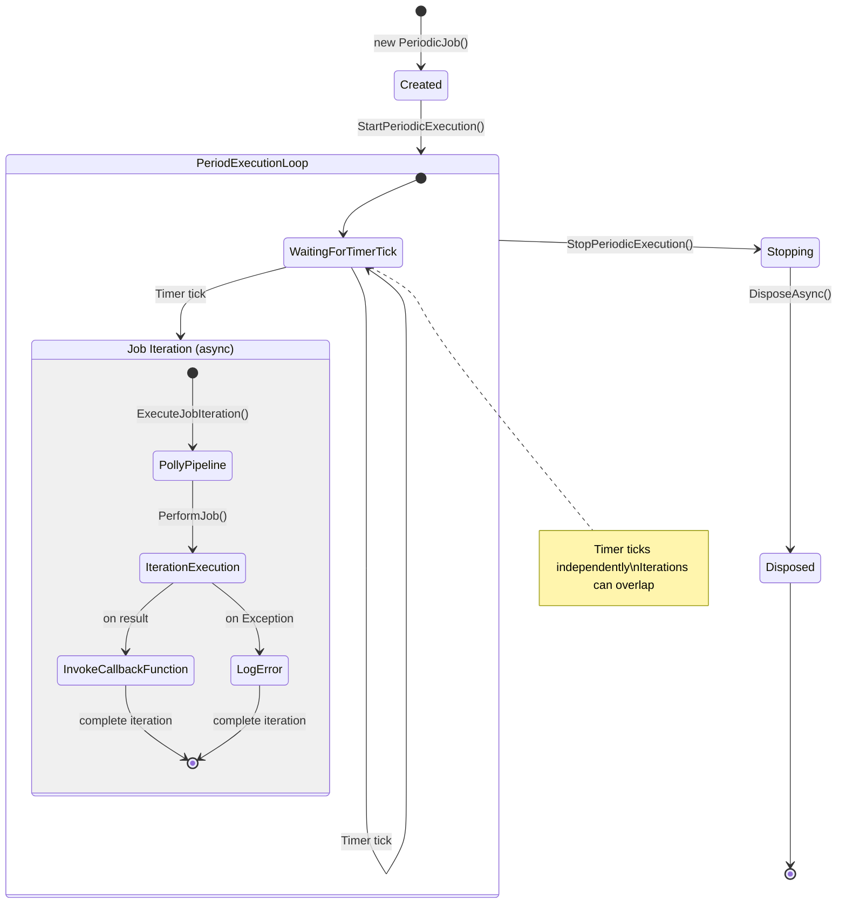
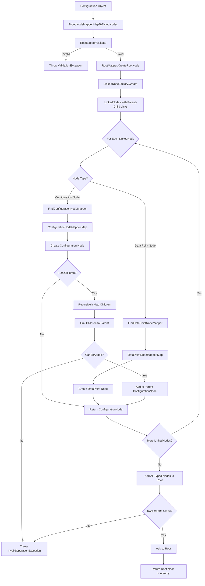

# DataPort Extensions Component Architecture

This document describes the reusable architectural components in the DataPort Extensions package. These components provide generic patterns for periodic job execution and configuration mapping that are independent of protocol-specific logic.

## Documentation Index

The Common components are organized into several focused documentation files:

| Document | Components | Description |
|----------|-----------|-------------|
| **[Overview.md](Overview.md)** | All components | This document - high-level overview of all common components |
| **[Queue.md](Queue.md)** | ChannelQueue, QueueStrategy | Thread-safe bounded queue with configurable overflow strategies |
| **[Resilience.md](Resilience.md)** | RetryBackoffCalculator, IDelayProvider | Retry and backoff calculation utilities |
| **[Exceptions.md](Exceptions.md)** | ConnectionFailureException, DataRetrievalException, InvalidConfigurationException, QueueBackpressureException | Standard exception types for DataPort operations |
| **[Logging.md](Logging.md)** | FormattedExternalValues | Efficient lazy formatting for structured logging |
| **[Model.md](Model.md)** | IDataPoint, IPollingDataPoint, IDataPointPollingGroup, Channels, PollFrequency, QueueConfiguration | Core abstractions and value types |

For detailed information about a specific component, see the corresponding documentation file.

---

## PeriodicJob

**Namespace**: `ViciOne.Suite.DataPort.Extensions.PeriodicJob`

Provides infrastructure for executing tasks at regular intervals with built-in resilience and lifecycle management.

### PeriodicJob<TJobInput, TJobOutput>

- **Location**: `src/Extension/PeriodicJob/PeriodicJob.cs`
- **Purpose**: Abstract base class for periodic task execution
- **Reusability**: Generic abstraction that can be used for any periodic task, not just S7 polling
- **Key Features**:
  - Type-safe jobs with defined input and output types
  - Integrated resilience via Polly (circuit breaker, timeout)
  - Overlapping execution support (non-blocking iterations)
  - Structured logging with event IDs
  - Testability through dependency injection

### Job Lifecycle

Jobs follow a standard lifecycle:

1. **Creation** - Job is instantiated with configuration and dependencies
2. **Start** - `StartPeriodicExecution()` begins background timer loop
3. **Execution** - Timer triggers iterations; jobs can overlap if previous iteration is still running
4. **Stop** - `StopPeriodicExecution()` cancels timer and waits for completion
5. **Disposal** - Resources cleaned up via `IAsyncDisposable`



### DefaultResiliencePipeline

- **Location**: `src/Extension/PeriodicJob/DefaultResiliencePipeline.cs`
- **Purpose**: Provides sensible default resilience strategies
- **Reusability**: Can be used with any periodic job requiring timeout and circuit breaker protection
- **Default Strategies**:
  - **Timeout**: 110% of execution interval (max 30 seconds)
  - **Circuit Breaker**: Opens after 50% failure rate over 10 calls
  - **Sampling window**: 10× execution interval (max 5 minutes)
  - **Break duration**: 2× execution interval (500ms-2 minutes) + 50ms delay

### PeriodicJobLogMessages

- **Location**: `src/Extension/PeriodicJob/PeriodicJobLogMessages.cs`
- **Purpose**: Structured logging messages with event IDs
- **Reusability**: Provides consistent logging patterns for any periodic job
- **Event ID Ranges**:
  - **1000-1099**: Job lifecycle events (starting, stopping, stopped, cancelled, errors)
  - **1100-1199**: Iteration events (starting, finished, exceptions)
  - **1200-1299**: Resilience events (circuit breaker state, timeouts)

**Log Message Patterns**:
- Lifecycle: `"Periodic job '{JobName}' ..."`
- Iterations: `"Iteration of job '{JobName}' ..."`

### Related Documentation

- **[Resilience.md](Resilience.md)**: Covers RetryBackoffCalculator used alongside PeriodicJob
- **[Model.md](Model.md)**: Documents IDataPointPollingGroup used as job input

## Typed Nodes System

**Namespace**: `ViciOne.Suite.DataPort.Extensions.TypedNodes`

Provides a framework for transforming weakly-typed configuration into strongly-typed object hierarchies.

### TypedNodeMapper<TSource, TTarget>

- **Location**: `src/Extension/TypedNodes/Mapping/TypedNodeMapper.cs`
- **Purpose**: Generic mapper for transforming configuration into typed nodes
- **Reusability**: Can be used for any configuration mapping scenario requiring validation and type safety
- **Features**:
  - FluentValidation integration
  - Recursive node mapping
  - Parent-child relationship linking
  - Extensible through custom mappers

### Mapping Process

1. Validates configuration using FluentValidation
2. Creates root typed node
3. Converts nodes to LinkedNodes (establishes parent-child relationships)
4. Maps each LinkedNode to a typed node recursively
5. Adds typed nodes to the root configuration



### Related Documentation

- **[Model.md](Model.md)**: Documents the model interfaces that TypedNodeMapper maps to
- **[Exceptions.md](Exceptions.md)**: Documents InvalidConfigurationException thrown during mapping

## Usage Examples

### Periodic Job Usage in S7

The S7 implementation uses the Periodic Job Framework:

```csharp
public class DataPointGroupPollingJob : PeriodicJob<DataPointGroup, List<DataPointValue>>
{
    protected override ValueTask<List<DataPointValue>> PerformJob(DataPointGroup input, CancellationToken token) =>
        s7Client.ReadAsync(input, token);

    protected override string GetJobName(DataPointGroup input) =>
        $"DataPointGroupPolling at [{input.PollFrequency.Value.TotalMilliseconds}ms] with [{input.DataPoints.Count} DataPoints])";
}
```

### TypedNodeMapper Usage in S7

The S7 implementation uses TypedNodeMapper:

```csharp
var mapper = TypedNodeMappers.S7TypedNodeMapper();
var deviceNode = mapper.MapToTypedNodes(s7Configuration);
```

## Extension Points

Both frameworks provide extension points for customization:

- **PeriodicJob**: Override `OnJobIterationExecutionException()` for custom error handling
- **TypedNodeMapper**: Implement custom mappers for specific node types
