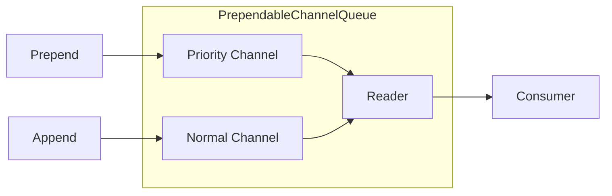

# Queue Components

**Namespace**: `ViciOne.Suite.DataPort.Extensions.Queue`

Provides thread-safe bounded queue infrastructure with configurable overflow strategies for managing data point write operations.

## Overview

The Queue components implement a simple yet robust queuing mechanism using .NET Channels, designed for single-reader/single-writer scenarios with backpressure handling.

## Components

### ChannelQueue<T>

**Location**: `src/Extension/Queue/ChannelQueue.cs`

**Purpose**: Bounded channel-based queue with configurable overflow strategy

**Key Features**:
- **Bounded capacity**: Fixed-size queue with configurable overflow behavior
- **Peek/Dequeue pattern**: Retry-safe processing that allows peeking without removal
- **Backpressure detection**: Count property enables monitoring of queue fullness
- **Thread-safe**: Optimized for single-reader, single-writer scenarios
- **Configurable overflow**: Choose between DropOldest or DropNewest strategies

**Usage Pattern**:

```csharp
// Create queue with DropNewest strategy
var queue = new ChannelQueue<DataPointValue>(
    capacity: 1000,
    boundedChannelFullMode: QueueStrategy.DropNewest,
    logger: loggerFactory.CreateLogger<ChannelQueue<DataPointValue>>(),
    name: "WriteQueue"
);

// Producer: Add items to queue
queue.Append(dataPointValue);

// Consumer: Peek-then-mark pattern for retry-safe processing
var item = await queue.PeekAsync(cancellationToken);
if (item != null)
{
    try
    {
        await ProcessItemAsync(item);
        await queue.MarkItemAsReadAsync(item, cancellationToken);
    }
    catch (Exception)
    {
        // Item remains in queue for retry
    }
}
```

**Lifecycle**:
1. **Creation**: Instantiate with capacity, strategy, logger, and name
2. **Operation**: Append items (producer), PeekAsync + MarkItemAsReadAsync (consumer)
3. **Completion**: Call CompleteAdding() to signal no more items
4. **Disposal**: Dispose to release resources

**Methods**:

- `Append(T item)`: Adds item to queue; drops item per strategy if full
- `PeekAsync(CancellationToken)`: Returns next item without removing it
- `MarkItemAsReadAsync(T item, CancellationToken)`: Removes item if still at head
- `IsItemStillHead(T item)`: Checks if peeked item hasn't been superseded
- `CompleteAdding()`: Signals no more items will be added
- `Dispose()`: Releases queue resources

**Properties**:
- `Capacity`: Maximum queue size
- `Count`: Current number of items in queue

### PrependableChannelQueue<T>

**Location**: `src/Extension/Queue/PrependableChannelQueue.cs`

**Purpose**: Lock-free bounded queue with both Append and Prepend operations using dual-channel architecture.

**Key Features**:
- **Dual-channel design**: Priority channel (prepended items) + Normal channel (appended items)
- **Priority processing**: Prepended items are always read before appended items
- **Lock-free operations**: Most paths use Interlocked operations, minimal locking
- **Same overflow strategies**: Supports DropOldest and DropNewest

**When to Use**:
- Use `ChannelQueue` when you only need append (FIFO) operations
- Use `PrependableChannelQueue` when you need to insert high-priority items at the front

**Architecture**:



**Usage Pattern**:

```csharp
var queue = new PrependableChannelQueue<DataPointValue>(
    capacity: 1000,
    overflowStrategy: QueueStrategy.DropOldest,
    logger: logger,
    name: "PriorityWriteQueue"
);

// Normal items go to the back
queue.Append(normalValue);

// Priority items go to the front
queue.Prepend(urgentValue);

// Consumer sees priority items first
var item = await queue.PeekAsync(cancellationToken);
// item is urgentValue (from priority channel)
```

**Batch Operations**:

```csharp
// Batch append (zero-allocation for arrays/lists)
queue.Append(itemsSpan);

// Batch prepend - items maintain order, first becomes new head
queue.Prepend(urgentItems);
```

**Methods** (in addition to ChannelQueue methods):

| Method | Description |
|--------|-------------|
| `Prepend(T item)` | Adds item to the front of the queue |
| `Prepend(ReadOnlySpan<T> items)` | Batch prepend with optimized overflow handling |
| `Prepend(IEnumerable<T> items)` | Prepend enumerable (optimized for arrays/lists) |

**Overflow Behavior**:
- **DropOldest**: Drops from normal channel first (preserves priority items)
- **DropNewest**: Rejects new items when full

---

### QueueStrategy

**Location**: `src/Extension/Queue/QueueStrategy.cs`

**Purpose**: Defines overflow behavior when queue reaches capacity

**Values**:
- `DropOldest`: Removes oldest item when queue is full (FIFO eviction)
- `DropNewest`: Removes newest item (current) when queue is full (reject new)

**Selection Guide**:
- **DropOldest**: Use when latest data is more important (e.g., real-time sensor readings)
- **DropNewest**: Use when data ordering matters more than recency (e.g., command sequences)

## Usage in S7 DataPorts

The S7 DataPort implementations use ChannelQueue for managing outgoing write operations:

```csharp
public class S7DataPortOutgoing
{
    private readonly ChannelQueue<List<DataPointValue>> _writeQueue;

    public S7DataPortOutgoing(QueueConfiguration queueConfig, ...)
    {
        _writeQueue = new ChannelQueue<List<DataPointValue>>(
            capacity: queueConfig.MaxPendingMessages,
            boundedChannelFullMode: queueConfig.Strategy,
            logger: logger,
            name: "S7WriteQueue"
        );
    }
}
```

## Design Considerations

**Why Peek/Dequeue Pattern?**
The separate peek and mark-as-read operations enable retry-safe processing:
- Peek operation doesn't remove the item
- If processing fails, item remains in queue for retry
- MarkItemAsReadAsync verifies item is still at head before removing
- Handles race conditions when DropNewest strategy supersedes items

**Why Single-Reader/Single-Writer?**
The Channel is optimized for this common pattern, providing:
- Better performance (no multi-writer contention)
- Simpler reasoning about item ordering
- Sufficient for typical DataPort scenarios

**Backpressure Handling**:
The queue exposes its current count, allowing consumers to implement backpressure logic:
```csharp
if (queue.Count > queue.Capacity * 0.8)
{
    logger.LogWarning("Queue at 80% capacity - backpressure detected");
}
```

## Choosing the Right Queue

| Scenario | Queue Type |
|----------|------------|
| Standard write buffering | `ChannelQueue<T>` |
| Need to prioritize certain writes | `PrependableChannelQueue<T>` |
| Retry failed writes with priority | `PrependableChannelQueue<T>` |
| Simple FIFO semantics | `ChannelQueue<T>` |

## Related Components

- **QueueConfiguration** (`src/Extension/Model/QueueConfiguration.cs`): Configuration record for queue settings
- **QueueBackpressureException** (`src/Extension/Exceptions/QueueBackpressureException.cs`): Exception for backpressure scenarios
- **OutgoingDataPortBase**: Primary consumer of ChannelQueue

---

**Last Updated**: 2026-01-30
