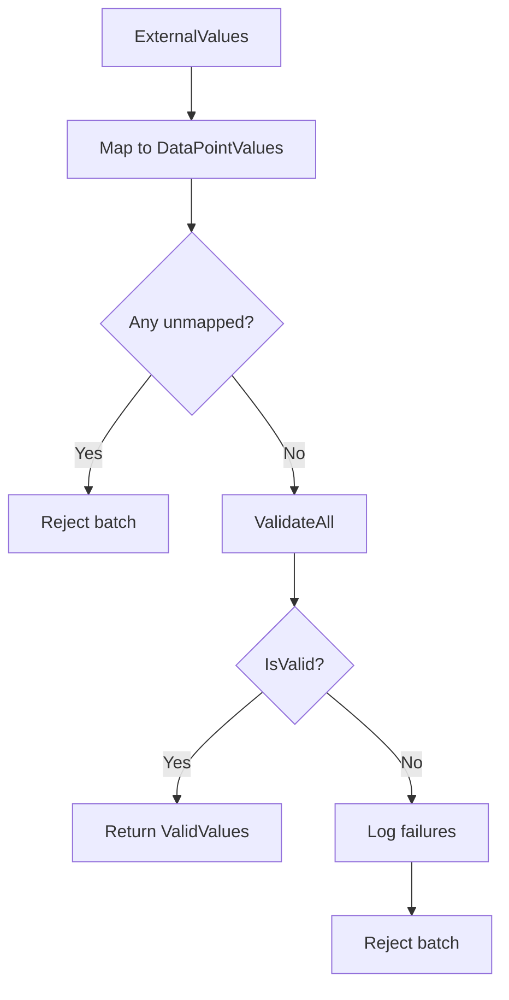

# Value Validation System

**Namespace**: `ViciOne.Suite.DataPort.Extensions.ValueValidation`

Provides validation infrastructure for data point values before writing to devices.

## Overview

The value validation system ensures that all values written to a device are valid before the write operation occurs. It uses **all-or-nothing semantics**: if any value in a batch fails validation, the entire batch is rejected. This prevents partial writes that could leave the device in an inconsistent state.

## Components

### DataPointValueValidator

**Location**: `src/Extension/ValueValidation/DataPointValueValidator.cs`

The main validator class that validates collections of data point values.

```csharp
public class DataPointValueValidator<TDataPoint, TDataPointValue>
    where TDataPoint : IDataPoint
    where TDataPointValue : IDataPointValue<TDataPoint>
{
    public DataPointValuesValidationResult<TDataPoint, TDataPointValue> ValidateAll(
        IReadOnlyCollection<TDataPointValue> dataPointValues);
}
```

**Validation Process**:

1. **Type Validation**: Calls `ValidateType()` on each value to verify the runtime type matches the expected data point type
2. **Range Validation**: Calls `IsInValueRange()` on each value to verify it's within valid bounds

**Usage**:
```csharp
var validator = new DataPointValueValidator<MyDataPoint, MyDataPointValue>(logger);
var result = validator.ValidateAll(dataPointValues);

if (result.IsValid)
{
    // All values passed - proceed with write
    await WriteAsync(result.ValidValues);
}
else
{
    // Some values failed - log failures, reject batch
    foreach (var failure in result.Failures)
    {
        logger.LogWarning("Validation failed: {Details}", failure.Details);
    }
}
```

---

### DataPointValuesValidationResult

**Location**: `src/Extension/ValueValidation/DataPointValuesValidationResult.cs`

Result record returned by the validator.

```csharp
public record DataPointValuesValidationResult<TDataPoint, TDataPointValue>(
    bool IsValid,
    IReadOnlyList<TDataPointValue> ValidValues,
    IReadOnlyList<DataPointValueValidationFailure<TDataPoint>> Failures)
    where TDataPoint : IDataPoint
    where TDataPointValue : IDataPointValue<TDataPoint>;
```

**Properties**:
| Property | Type | Description |
|----------|------|-------------|
| `IsValid` | `bool` | True if all values passed validation |
| `ValidValues` | `IReadOnlyList<TDataPointValue>` | Successfully validated values |
| `Failures` | `IReadOnlyList<DataPointValueValidationFailure<TDataPoint>>` | Validation failures |

---

### DataPointValueValidationFailure

**Location**: `src/Extension/ValueValidation/DataPointValueValidationFailure.cs`

Record describing a single validation failure.

```csharp
public record DataPointValueValidationFailure<TDataPointType>(
    TDataPointType DataPoint,
    object? ActualValue,
    ValidationFailureReason Reason,
    string Details) where TDataPointType : IDataPoint;
```

**Properties**:
| Property | Type | Description |
|----------|------|-------------|
| `DataPoint` | `TDataPointType` | The data point that failed validation |
| `ActualValue` | `object?` | The runtime value that failed |
| `Reason` | `ValidationFailureReason` | Enumerated reason for failure |
| `Details` | `string` | Human-readable failure description |

---

### ValidationFailureReason

**Location**: `src/Extension/ValueValidation/ValidationFailureReason.cs`

Enumeration of validation failure reasons.

```csharp
public enum ValidationFailureReason
{
    TypeMismatch,
    ValueOutOfRange
}
```

| Value | Description |
|-------|-------------|
| `TypeMismatch` | Runtime value type doesn't match configured data point type |
| `ValueOutOfRange` | Value is outside valid bounds for the data type |

---

### TypeValidationResult

**Location**: `src/Extension/ValueValidation/TypeValidationResult.cs`

Result returned by `IDataPointValue.ValidateType()`.

**Properties**:
| Property | Type | Description |
|----------|------|-------------|
| `IsValid` | `bool` | True if type is valid |
| `ActualType` | `Type?` | The actual runtime type |
| `AllowedTypes` | `IReadOnlyList<Type>` | List of allowed types |

---

## IDataPointValue Interface

Data point values must implement `IDataPointValue<TDataPoint>` to support validation:

```csharp
public interface IDataPointValue<TDataPointType> where TDataPointType : IDataPoint
{
    object? Value { get; init; }
    TDataPointType DataPoint { get; init; }

    bool IsInValueRange();
    TypeValidationResult ValidateType();
}
```

**Method Implementations**:

### IsInValueRange

Returns true if the value is within valid bounds for the data type.

**Example**:
```csharp
public bool IsInValueRange()
{
    if (Value is null) return true;

    return DataPoint.DataType switch
    {
        "Int16" => Value is short,
        "UInt16" => Value is ushort s && s <= DataPoint.MaxValue,
        "String" => Value is string str && str.Length <= DataPoint.MaxLength,
        _ => true
    };
}
```

### ValidateType

Validates that the runtime value type is compatible with the data point type.

**Example**:
```csharp
public TypeValidationResult ValidateType()
{
    if (Value is null)
        return TypeValidationResult.Valid;

    var allowedTypes = DataPoint.DataType switch
    {
        "Bool" => new[] { typeof(bool) },
        "Int16" => new[] { typeof(short), typeof(int) },
        "Real" => new[] { typeof(float), typeof(double) },
        _ => Array.Empty<Type>()
    };

    var actualType = Value.GetType();
    var isValid = allowedTypes.Contains(actualType);

    return new TypeValidationResult(isValid, actualType, allowedTypes);
}
```

---

## Integration with OutgoingDataPortBase

The `OutgoingDataPortBase` uses the validation system in its `GetDataPointValues` method:



The validation runs automatically - implementations only need to implement `IDataPointValue` correctly.

---

## Logging

The validator logs failures with structured messages:

- **Type Mismatch**: `"Value has wrong type for channel {Channel} at {Address}: expected {AllowedTypes}, got {ActualType}"`
- **Value Out of Range**: `"Value out of range for channel {Channel} at {Address}: '{Value}' is invalid for {DataType}"`

---

## Related Components

- [OutgoingDataPort](OutgoingDataPort.md) - Uses validation during write processing
- [IDataPointValueFactory](Interfaces.md#idatapointvaluefactory) - Creates values to be validated
- [Model](Model.md) - Data point and value interfaces

---

**Last Updated**: 2026-01-30
