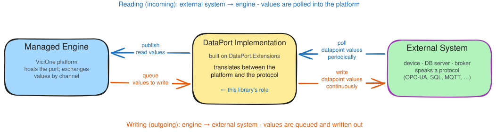
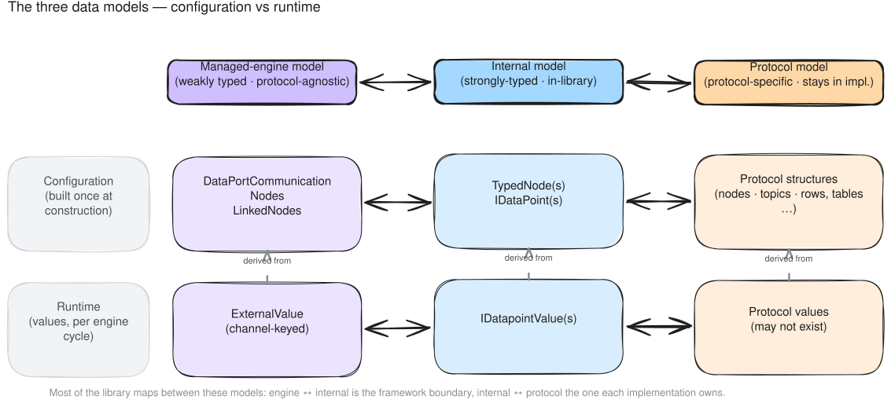
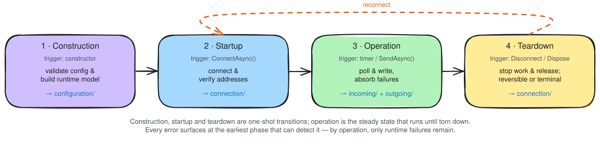
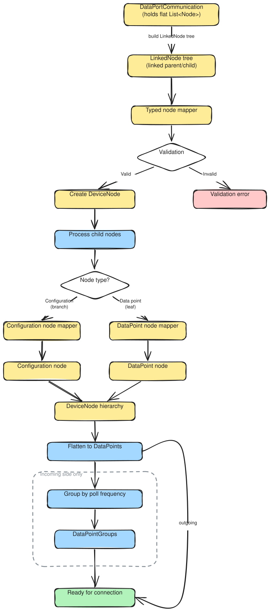
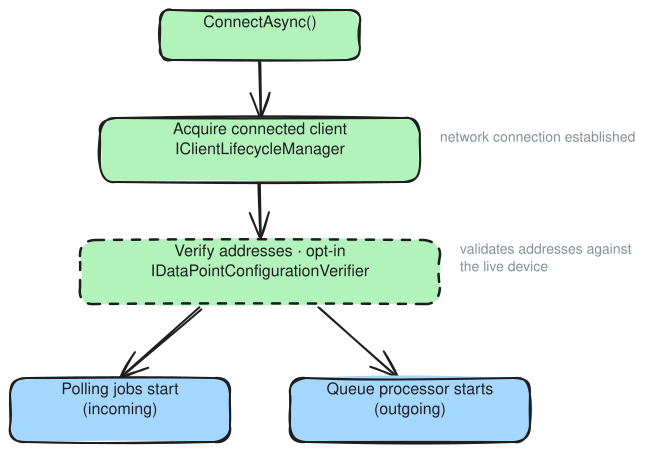
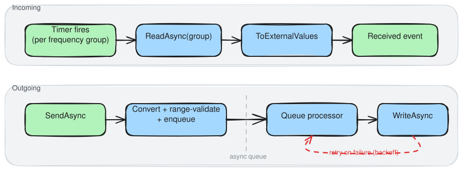

# DataPort.Extensions: Overview

This page is the complete conceptual picture of the library, and it is meant to be read on its own. By
the end of it you should understand what a DataPort is, where the boundary falls between the code you
write and the machinery the base classes already provide, which data models meet inside an
implementation, and how a data-port behaves across its lifecycle. The other documents under `explanation/`
go deeper on individual subsystems, but you should not need them to follow the argument here.

---

## What is a DataPort?

A **DataPort** is the ViciOne component that connects the platform to a single external device or system
speaking one particular protocol, whether that is an OPC-UA server, a SQL database, or an MQTT broker.
It moves data between the two in either direction:

- **Reading (incoming):** the external system's values are polled and flow up into the platform.
- **Writing (outgoing):** the platform's values flow down and are written to the external system.

Three actors take part. At one end is the **managed engine**, the ViciOne platform that hosts the port
and exchanges values with it. At the other end is the **external system**, which exposes read and write
operations through its protocol. The **DataPort implementation** sits in between and translates between
the two, and this library is the reusable foundation you build that middle piece on.

---

## What the DataPort.Extensions library provides

The whole point of the library is that protocol implementations should not each have to rebuild the same
infrastructure.
Cross-cutting concerns such as a strong domain model, connection handling, polling, write queuing, etc. are solved once,
in the
base classes. What an individual implementation adds is only the part
that is genuinely specific to its protocol, such as the network client, the shape of its YAML
configuration, and the format and types of its data-points. The base classes take those pieces and wire them
together.

What you are left with is a much smaller job. Building a new protocol implementation becomes mostly a
matter of answering protocol-specific questions, rather than re-solving general ones like "what happens if a singular
poll-request fails?" or "how do we keep from dropping writes during a transient
failure?".

The answer the base classes encode is an **opinionated** one: a single, end-to-end way of fitting the
pieces together. Most implementations take it whole by inheriting from `IncomingDataPortBase` or
`OutgoingDataPortBase`. It is not all or nothing, though. Many of the building blocks are public and
stand on their own, so an implementation with unusual needs can pick out just the parts it wants and
assemble its own port without inheriting from the base classes at all.

The extension is currently built for protocols that are connection-oriented and pull-based for reading data. A port owns
and manages a connection, and it obtains incoming values by polling the external system on a schedule rather than
waiting for the system to push them. A protocol that
behaves differently does not sit naturally on the current design, and would require some adoptions or an alternative
base-port-class.

---

## What you implement, and what the base class handles

The base classes handles the control-flow. A port spends its whole life being driven by base-class code:
it sequences the phases, runs the polling timers, works the write queue, and applies the retries and
resilience that keep a port alive through trouble. Your implementation never owns that flow. It only
gets called at a fixed set of points.
Each extension points defines where the base-class needs something only your protocol can provide, such as "How to open
and close a connection to the external system?"
or "How to turn the raw results of a reading into a typed value that matches what the ViciOne-framework expects?"

The implementation of the extension-point are the main-todos when using this library to build a data-port, and much of
understanding the extension is knowing where they are and
why they fall where they do.

The implementations you supply are:

- **Connection lifecycle** (`IClientLifecycleManager`). This acquires a connected client and later
  releases it. How the connection is actually managed changes for reasons that have nothing to do with
  reading or writing, whether it is opened fresh each time, kept alive as a shared session, or borrowed
  from a pool, which is why it lives behind its own interface instead of inside the I/O code.
- **Protocol I/O** (`IReadClient` for incoming, `IWriteClient` for outgoing). This is the code that
  actually talks to the device, reading a group of data points or writing a batch of values in one call.
  The batching is on purpose. On most device protocols, fetching fifty addresses in a single round trip
  costs barely more than fetching one, and the same holds going the other way.
- **Configuration mapping** (the per-node mappers, plus `IDataPointsMapper` or `IDataPointGroupsMapper`).
  These turn the raw configuration into a validated, typed tree and then flatten that tree into the
  runtime data points, adding poll-frequency groups for incoming ports. The base class cannot do this on
  its own, because only the protocol knows what its nodes mean and how an address is put together. The
  [data models](#configuration-and-the-data-models) section below describes the result in more detail.
- **Value conversion** (`ConvertToDataPointValue`, outgoing only). When a value comes down from the
  engine it arrives as an untyped `object?`, and this seam is where you turn it into the data point's
  declared .NET type or explain why you cannot. The conversion is specific to the protocol, so it belongs
  to you; the base class only decides when it runs and what happens if it fails.
- **Optional hooks.** A few behaviors ship with defaults that are good enough most of the time, so you
  reach for them only when your protocol or your deployment needs something else. `CreateConfigurationVerifier`
  lets you check the user's configuration against metadata from the connected external system before operation begins.
  `ToExternalValues` lets an incoming port decide how read results map onto channels. `RetryPolicy` and
  `QueueConfiguration` let an outgoing port tune how it retries and what it does when its queue overflows.

Everything outside those methods is the base class's job, and no implementation has to solve it again.

---

## Configuration and the data models

### Where the configuration comes from

Everything a concrete port does traces back to a schema written in YAML against a schema defined by ViciOne.
A **dataport-author** uses it to declare which parts of a protocol ViciOne should expose. A user
then configures an actual external system against that declaration in the suite's editor.
Finally, users configure **dataflows** that decide which values actually move between the engine and the external system.

The port itself never sees any of that. It is handed its configuration at runtime as a single
**`DataPortCommunication`** object, and values cross the boundary as `ExternalValue`s keyed by
channel, where a channel is just a hierarchical identifier that points back at an object in the
configured tree. From there the managed engine drives the port through a small contract for the incoming
and outgoing directions.

Where this configuration comes from, and how channels and dataflows work, is upstream of this library.
See [DataPortCommunication](../../DataPort/explanation/data-port-communication.md) and
[LinkedNode and channels](../../DataPort/explanation/linked-node.md).

### The three data models

A DataPort implementation is essentially an adapter between the protocol it implements and the ViciOne
interface, so three data models meet inside it.

- The **managed-engine model** is weakly typed and protocol-agnostic, which is what lets the platform
  host any protocol without taking a dependency on its types. Configuration reaches the port as
  `DataPortCommunication`, and values arrive as `ExternalValue`s keyed by channel.
- The **internal model** is the strongly-typed world inside the library. Once construction is done, the
  rest of the code works with validated objects rather than dictionaries and bare `object`s.
- The **protocol model** is whatever the underlying client uses to reach the device, such as OPC-UA
  nodes, SQL rows, or MQTT topics. It is entirely specific to the protocol and never leaks above the
  implementation.

Each model has two sides: a configuration side that describes connections, structure, and what the
device can do, and a runtime side made up of the values that flow on each cycle. Most of what this
library does is map between the three. The mapping between the engine model and the internal model is the
central boundary the library manages, and the mapping between the internal model and the protocol model
is the boundary each implementation owns.

### Type is carried by the CLR, not a discriminator

Inside the internal model, a data point's type is not recorded in an enum or a string discriminator off
to the side. The type is the CLR type argument itself, through `ITypedDataPoint<TValue>`. A value in
flight carries the same guarantee through `ITypedDataPointValue<TValue>`, so a value and its data point
cannot disagree about their type at runtime. The only way for a value to be the wrong type is for it to
have failed conversion earlier, before the value object ever existed. That one decision removes a whole
class of runtime type-mismatch bugs, and it is the reason the outgoing write path has a conversion gate
but no separate type check, as the [Operation](#operation-steady-state) section explains below.

---

## The lifecycle of a data-port

Once a dataflow involving a dataport is deployed, the managed engine creates the port from its
configuration and drives it through a lifecycle that every dataport shares. Three of the phases are
one-shot **transitions**. The fourth, operation, is a continuous **steady state** that runs on its own
once entered, until something tears it down.

> construction → startup → **operation (steady state)** → teardown. A *reversible* teardown loops back
> to startup.

One principle runs through all four phases: **every error should surface at the earliest phase that can
detect it.**

* An invalid configuration fails at construction, before the network is ever touched.
* Any check that needs a live system happens at startup, on the first connect.
* By the time a port reaches operation, both its configuration and its connection have been validated, so
  the only failures left are runtime ones.
* Teardown adds no new kind of failure. It only winds things down.

### Construction

The managed engine creates a new instance of your data dataport implementation and provides an instance of your specific
`DataPortCommunication` class with the information that the user configured.
The incoming `DataPortCommunication` is mapped, validated, and
converted into the strongly-typed runtime model the port will use from then on. Any structural problem
with the configuration surfaces right here.
The validation is purely on statically defined rules with a connection to the external system.
Some constraints can also be defined in the yaml (but are not yet validated in the ui-editor) but some validations
require more logic than what can be expressed in a yaml-file.

This happens in two layers. The raw configuration first becomes a **validated, strongly-typed node
tree**. Protocol-specific mappers turn each configured node into a typed one, and because validation
gates that step, a malformed configuration fails predictably here at construction instead of somewhere
deep in operation. The tree follows the device's own physical hierarchy, which is where addresses come
from in the first place. Once the tree exists it is **flattened into the internal runtime model**, a flat
and indexed list of data points that, for incoming ports, is partitioned by poll frequency. The
flattening is deliberate: at runtime the port wants fast repeated access, a constant-time lookup from
channel to data point for writes and ready-made groups for polling, and a tree gives it neither.

→ [Typed node model](configuration/typed-node-model.md) · [Internal data model](configuration/internal-data-model.md)

### Startup

Startup is also a one-shot transition. `ConnectAsync` opens the network connection and, if the
implementation asks for it, verifies the configured addresses against the live system. Only after that
succeeds does any background work start, which means polling jobs for an incoming port or the write-queue
processor for an outgoing one. The failures that show up at this stage are exactly the ones you cannot
detect without a live system to talk to.

Verification is opt-in, and for good reason. Not every protocol can check an address cheaply; on some,
the only way to know whether an address exists is to read it in full, which costs as much as polling
would. When an implementation does supply a verifier, it checks every configured address against the live
device, and the first failure aborts startup and cleans up the connection. Without that step a
misconfigured address becomes a silent data gap: a port that looks perfectly healthy while a handful of
its data points quietly never produce a value. Verification turns that into a loud, early failure
instead.

→ [Connection lifecycle](connection/connection-lifecycle.md) · [Client lifecycle manager](connection/client-lifecycle-manager.md) · [Configuration verification](connection/configuration-verification.md)

### Operation (steady state)

Operation is the one phase that is not a one-shot transition. Once startup finishes, the port runs on its
own and keeps running, and it is built to stay up through trouble. Transient failures are the normal
case here rather than the exception, whether that is a brief network blip, a device restart, or a short
maintenance window, and the port absorbs them in place instead of falling over. Both directions ran their
configuration through the same typed-node transformation back at construction. What sets them apart is
what they do with the resulting data points once they are live.

#### Incoming polling

An incoming port reads the device on a schedule and publishes what it gets back as `ExternalValue`
events. The decision that shapes everything else is to poll **by group rather than by individual data
point**. All the data points that share a `PollFrequency` are read together, on one timer, in a single
call. The alternative, a timer per data point, fails in two ways at once: it spawns far more background
timers than the thread pool wants to carry, and it throws away the cheap batch reads most protocols
offer, where pulling fifty registers in one transaction costs barely more than pulling one. With
grouping, the number of live timers is simply the number of distinct frequencies in the configuration,
usually a handful, no matter how many data points there are.

Resilience here is built in rather than configured. Every polling group runs inside a pipeline the base
class wraps around it, with a timeout and a circuit breaker. One failed read never stops a group. The
circuit breaker opens once failures pile up and closes again on its own when the device comes back, and
because each group has its own breaker, a group polling once an hour can be stuck while a group polling
every hundred milliseconds carries on untouched. After each read, a `ToExternalValues` step maps the raw
results onto channel values.

→ [Incoming data port](incoming/incoming-data-port.md) · [Polling jobs](incoming/polling.md)

#### Outgoing writing

An outgoing port takes values from the engine and writes them to the device, but never directly.
Everything goes through a **background queue**. `SendAsync` resolves the channels, converts and
range-checks the batch, puts it on the queue, and returns straight away, while a separate background
processor is what actually writes to the device. That processor writes in order, which matters on
state-based devices where output is cumulative: a failed write is retried at the head of the queue rather
than letting newer values overtake it. The point of the queue is to keep the engine cycle clear
of however long a write might take. A single write can finish in microseconds, take whole seconds, or
fail outright and have to be retried, and none of that should be allowed to stall the cycle that called
`SendAsync`. The trade is that a write failure never makes its way back to the caller; it is logged and
retried instead. On an industrial write path, where the caller has nothing useful to do about a
transient failure anyway, that is the right call.

On its way to the device, a value passes through **two gates, both all or nothing**. The first is
**conversion**, which asks whether the untyped value can be represented as the data point's declared .NET
type at all. The second is **range validation**, which asks whether the now-typed value falls inside the
bounds the data point allows. Notice there is no type check sitting between the two. The strongly-typed
value model makes one unnecessary, since a value of the wrong type can only ever surface as a conversion
failure in the first place. If any value in a batch fails either gate, the entire batch is dropped rather
than written in part. That sounds heavy-handed until you picture a state-based device, where values are
often related and writing half of a coordinated group can leave the device in an inconsistent state.

Two further decisions round out the write path. By default the `RetryPolicy` keeps retrying forever,
backing off between attempts. In an industrial deployment a device that has briefly gone away will
usually come back, and a write that arrives late is almost always better than one that was quietly thrown
away. Where that reasoning does not hold, typically for informational writes whose receiver keeps no
state that has to stay in sync, `BoundedRetryPolicy` lets the port give up after a while. The other
decision is that `SendAsync` will not block and will not throw when the queue is full. If it blocked, one
stuck write would drag down every other component sharing the engine cycle, so the bounded queue falls
back on its configured overflow strategy and lets the engine move on. A queue that stays full is a signal
in itself: the port has become a bottleneck, nearly always because the item at the head is stuck in
retry.

→ [Outgoing data port](outgoing/outgoing-data-port.md) · [Value conversion and validation](../reference/value-validation.md)

### Teardown

Teardown is a one-shot transition, and it comes in two forms that differ in one respect, which is whether
the port can come back afterwards.

- **`DisconnectAsync` is reversible.** It stops the background work and releases the client, but it leaves
  the validated port in memory. A later `ConnectAsync` simply loops back to startup and picks up where it
  left off. This is the path reconnection takes.
- **`DisposeAsync` is terminal.** It disconnects, releases the resources the subclass owns, and ends the
  port's life for good. A disposed port cannot be reused.

Neither form introduces a new class of failure. By the time either one runs, the configuration and the
connection were validated long ago.

→ [Connection lifecycle](connection/connection-lifecycle.md) · [Client lifecycle manager](connection/client-lifecycle-manager.md)

---

## How these docs are organized

This page holds the whole picture. The folders alongside it go further into individual subsystems, with
their own diagrams, their edge cases, and the finer points of why things are the way they are, but they
are meant to deepen what is here rather than replace it. Each folder lines up with the phase it is most
active in, though not perfectly: operation is split across `incoming/` and `outgoing/`, and `connection/`
turns up in both startup and teardown.

| Folder                                                  | Phase        | Elaborates                                                                        |
|---------------------------------------------------------|--------------|-----------------------------------------------------------------------------------|
| [`configuration/`](configuration/typed-node-model.md)   | construction | turning the engine's configuration into a validated, strongly-typed runtime model |
| [`connection/`](connection/connection-lifecycle.md)     | startup      | opening, closing, and re-establishing the connection, and verifying it against the live external system |
| [`incoming/`](incoming/incoming-data-port.md)           | operation    | the read / poll pipeline                                                          |
| [`outgoing/`](outgoing/outgoing-data-port.md)           | operation    | the write / queue pipeline                                                        |

---

## Further Reading

**DataPort (upstream)**

- [DataPortCommunication](../../DataPort/explanation/data-port-communication.md): what the communication object carries
  and where it comes from
- [LinkedNode and channels](../../DataPort/explanation/linked-node.md): tree reconstruction and the channel system

**DataPort.Extensions: How-to and Reference**

- [Incoming data port](../how-to/incoming-dataport/incoming-data-port.md) · [Outgoing data port](../how-to/outgoing-dataport/outgoing-data-port.md)
- [Interfaces](../reference/interfaces.md) · [Model](../reference/model.md) · [Value conversion and validation](../reference/value-validation.md)
