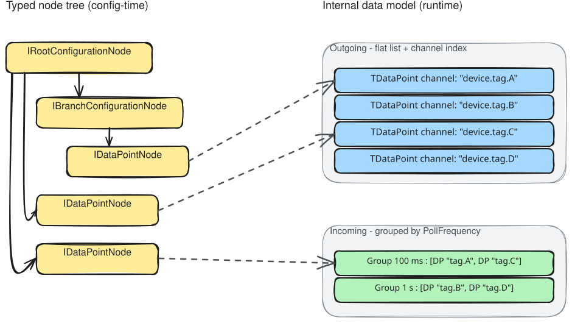

# Internal Data Model: Design Rationale

The internal data model is the runtime representation the data port uses during its operational lifetime: polling, writing, and channel resolution. It is produced from the typed node tree and is deliberately simpler: the hierarchical `DeviceNode` tree is set aside, and only flat, indexed structures are used at runtime.

> **Looking for contracts and types?** See [Model](../../reference/model.md) and [Mapping interfaces](../../reference/interfaces.md#mapping-interfaces).

---

## Why a separate runtime model

One could map `LinkedNode`s directly to data points and polling groups, skipping the typed node tree entirely. The [typed node model](typed-node-model.md) is a deliberate intermediate that handles validation and semantic enrichment. Once that work is done at startup, the tree structure has served its operational purpose, though it is kept as `DeviceNode` for debugging and introspection.

At runtime, a data port never needs to traverse the node tree again. What it needs is:

- **Outgoing**: an O(1) lookup from channel string to data point, called on every engine cycle
- **Incoming**: data points partitioned by poll frequency, since each polling job needs exactly its group on every tick

Neither of these access patterns benefits from a tree. The internal model abandons the hierarchy and optimises for these two patterns instead. Grouping by poll frequency is an example of this: it is meaningless at configuration time but critical for runtime efficiency. It determines how many polling timers exist and how many data points get batched into each read call.

---

## The outgoing model: a flat indexed list

An outgoing data port receives `ExternalValue` instances on every engine cycle, each carrying a channel string. The port must resolve each channel to a concrete `TDataPoint`: the typed, protocol-specific object the write client uses.

The internal model for outgoing ports is a flat `IReadOnlyList<TDataPoint>` built once at startup, backed by a dictionary indexed by channel string for O(1) resolution. Resolution cost does not grow with the number of data points, which matters because `SendAsync` is called on every engine cycle.

---

## The incoming model: grouped by poll frequency

An incoming data port runs one polling job per distinct `PollFrequency`. Each job calls `IReadClient.ReadAsync` with its group on every tick: one batch read per group per tick.

The internal model for incoming ports extends the flat list with grouping: data points sharing the same `PollFrequency` are placed in the same `IDataPointPollingGroup`. The number of active polling timers equals the number of distinct frequencies in the configuration, not the number of data points.

This also aligns with how most device protocols work: reading 50 registers in one call is orders of magnitude cheaper than 50 individual calls. Grouping by frequency naturally produces batches that match protocol-level bulk read operations.

---

## IDataPointsMapper and IDataPointGroupsMapper as the bridge

The transition from typed node tree to internal model is performed by two mapper interfaces.

`IDataPointsMapper` traverses the typed node tree and produces a flat `IReadOnlyList<TDataPoint>`. This is what outgoing ports need.

`IDataPointGroupsMapper` extends `IDataPointsMapper` and adds frequency-based partitioning. It produces both the flat list and a set of `IDataPointPollingGroup` instances for use by the polling job infrastructure. This is what incoming ports need.

They are separate interfaces because poll frequency is a concept that outgoing ports do not have. An outgoing data point has an address and a type but no polling interval. Forcing outgoing mapper implementations to implement `CreateGroup` and carry the `IPollingDataPoint` constraint would leak incoming-port semantics into code where they have no meaning.

`IDataPointGroupsMapper` inherits from `IDataPointsMapper`, so it can be used anywhere the flat mapper is expected. Implementing it requires only `ToDataPoints` (the tree walk) and `CreateGroup` (how to construct a group for a given frequency); the partitioning logic itself has a default implementation.

---

## Type is carried by the type system, not a discriminator

A data point's type is not recorded in an enum or a string discriminator off to the side. The type is
the generic type argument itself, through `ITypedDataPoint<TValue>`, and a value in flight carries the
same guarantee through `ITypedDataPointValue<TValue>`. Because both are bound to the same `TValue` at
compile time, a value and its data point cannot disagree about their type at runtime. The only way for
a value to be the wrong type is for it to have failed conversion earlier, before the value object ever
existed.

That one decision removes a whole class of runtime type-mismatch bugs. It is also the reason the
outgoing write path has a conversion gate but no separate type check, a point covered in
[Value conversion and validation](../../reference/value-validation.md).

---

## Why the data point model is split across several interfaces

The runtime model uses several data point interfaces rather than one. Three distinct concerns pull in different directions, and the split keeps each of them out of the others' way.

The first split is **definition versus value in flight**. `IDataPoint`, refined by `ITypedDataPoint<TValue>`, is the static definition built once at startup. `IDataPointValue`, refined by `ITypedDataPointValue<TValue>`, is a value moving through the port on a given cycle: the definition paired with a concrete value. The two have different lifetimes, so they are different types. The write queue and write client operate on values, never on definitions directly.

The second split is **direction**. `IPollingDataPoint` adds `PollFrequency`, a concept that only incoming data points have. Keeping it on its own interface stops it leaking into outgoing data point types, and it is also what lets `IDataPointGroupsMapper` partition by frequency: a data point that implements `IPollingDataPoint` can be grouped, one that doesn't cannot.

The third split is **generic versus non-generic**. `IDataPointValue` is non-generic, so a single port can carry values of differing .NET types through one common type. `ITypedDataPointValue<TValue>` ties the payload to the data point's declared type at compile time, which is what removes the need for a separate runtime type check on the write path.

For the interface signatures and members, see [Model reference](../../reference/model.md).

---

## Related

- [Typed node model](typed-node-model.md): the configuration-time model that this one is derived from
- [Model reference](../../reference/model.md): `IDataPoint`, `IPollingDataPoint`, `IDataPointValue`, `Channels`, `PollFrequency`
- [Mapping interfaces](../../reference/interfaces.md#mapping-interfaces): `IDataPointsMapper` and `IDataPointGroupsMapper` signatures
