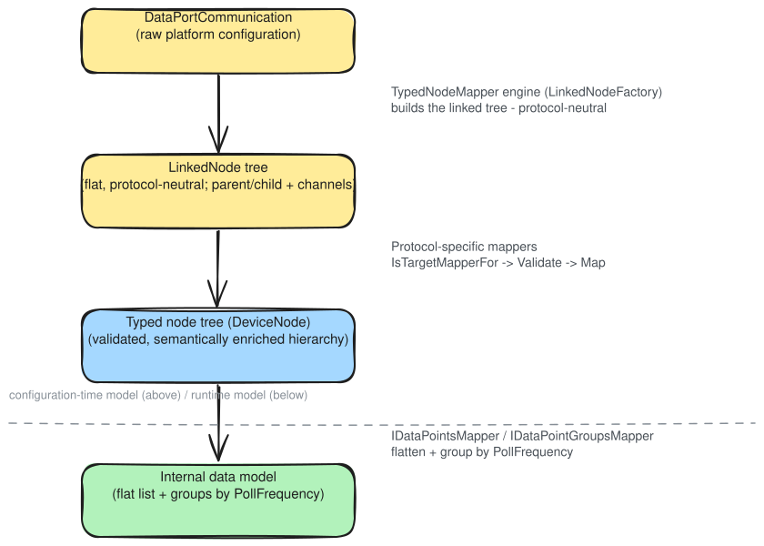
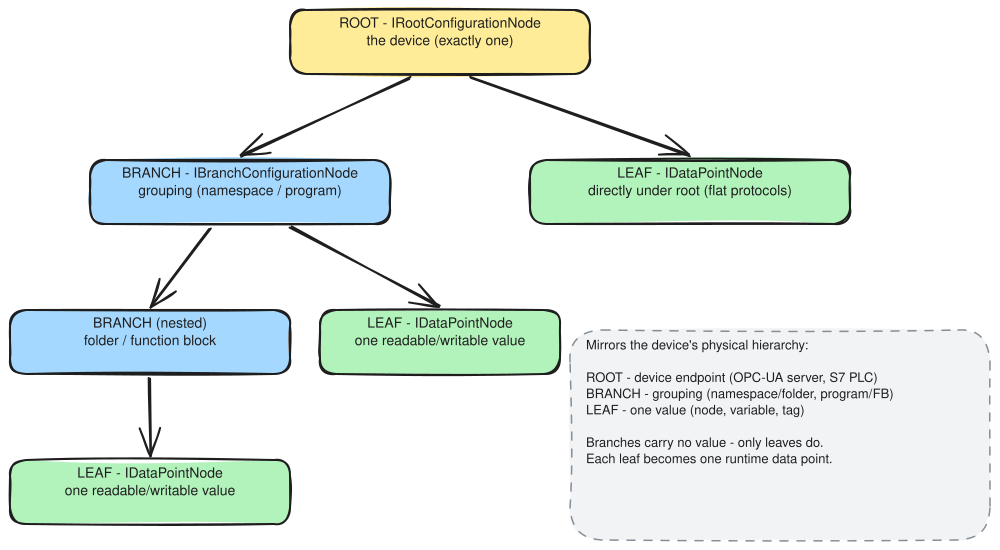
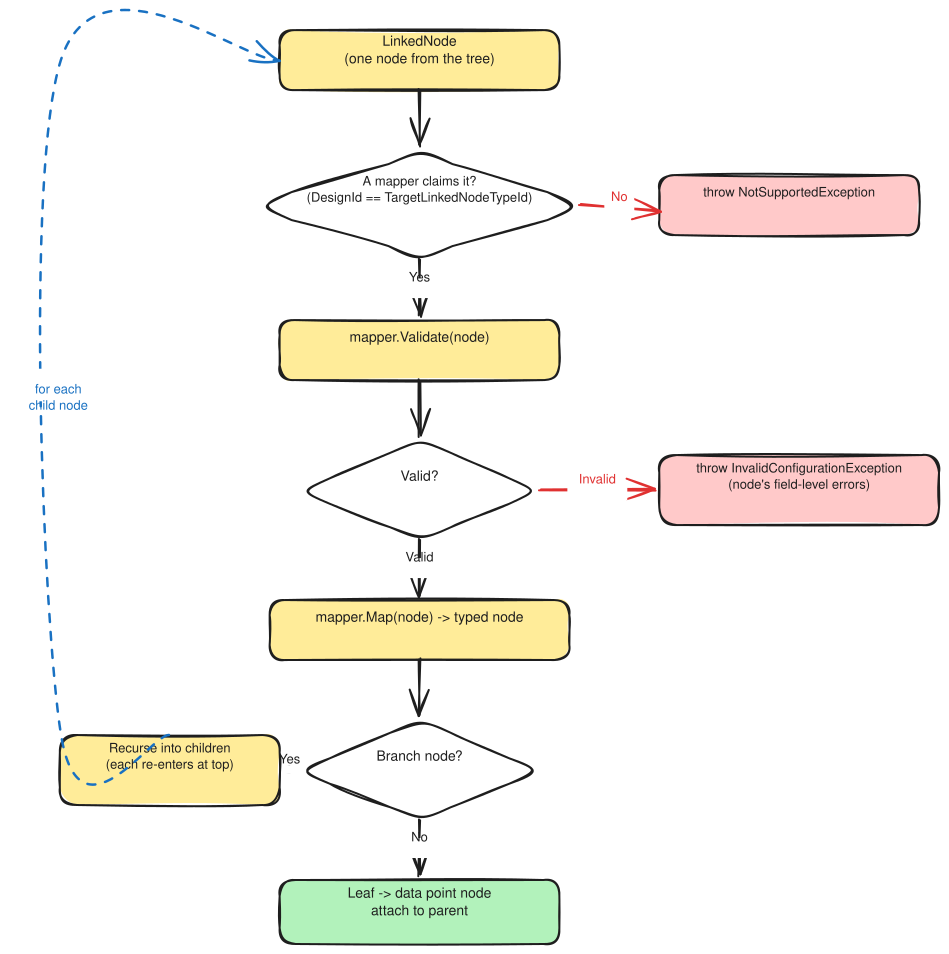

# Typed Node Model: Design Rationale

The typed node model is the configuration-time representation of a DataPort's configuration. It sits between the raw
`DataPortCommunication` with its flat list of `Nodes`  handed in at construction and the runtime data structures the
data port uses during operation.

The pipeline below shows where it sits and, for each step, which layer owns the transition: the platform-neutral
`TypedNodeMapper` engine, the protocol-specific mappers, or the runtime mapper bridge.

> **Looking for contracts and types?** See [Model reference (TypedNodes)](../../reference/model.md#typednodes).

The pipeline above is the *data* view, showing what becomes what. The flowchart below is the *control*
view: the order in which `TypedNodeMapper.MapToTypedNodes` runs those steps. It validates the root, builds
the `LinkedNode` tree, then walks it, dispatching and recursing per node before assembling the root. The
sections that follow explain why each step falls where it does. The per-node decision at the centre is
detailed under [Why validation runs before mapping](#why-validation-runs-before-mapping).

---

## Why a dedicated configuration model

It would be possible to map `LinkedNode`s directly to data points and polling groups without a typed node tree. The
typed node model is a deliberate detour: it exists because configuration-time concerns and runtime concerns are
different.

At configuration time, the questions are: Is this configuration valid? What does this node mean? What address does this
data point carry? What type is it? These require a rich, hierarchically structured representation that preserves all
semantic context.

At runtime, the questions are: Which data points do I poll together? How do I look up a data point from a channel
string? These require flat, indexed structures optimised for repeated access.

The typed node model handles the first set of concerns: validation, semantic enrichment, and hierarchy assembly.
The [internal data model](internal-data-model.md) handles the second. Separating them means neither has to compromise
for the other's access pattern.

The rest of this section covers the three decisions that give the model its shape: it is a tree, its nodes come in three roles, and those nodes are strongly typed.

### A tree that mirrors the schema

The typed node model is a tree because the configuration it represents is already one. The ViciOne configuration schema,
defined in YAML, models a DataPort's configuration as a hierarchy of nodes, with each node type declaring the child node
types and properties it may carry. The input is therefore not free-form: `DataPortCommunication` delivers nodes that
`LinkedNode` reconstitutes into that hierarchy from their parent references. The typed node model mirrors this
schema-defined structure rather than inventing one of its own.

That hierarchy usually follows how the underlying source is organised. A PLC has programs containing function blocks
containing variables; an OPC-UA server has namespaces containing folders containing nodes; other sources such as SQL or
time-series databases have their own containers and fields. DataPorts are not limited to devices, but in each case the
schema expresses the configuration as nested nodes, and the nesting carries meaning: a data point's protocol address is
often derived from its position in the hierarchy, so flattening it at configuration time would lose context the mappers
depend on.

The tree preserves these parent-child relationships so that mappers can navigate them when building typed nodes. Once
the internal data model is built, the tree is no longer needed for operational purposes. It is retained as `DeviceNode`
on the base class, primarily for debugging and introspection, but the operational phase never traverses it again.

### Three node roles

The tree is built from three distinct roles: root, branch, and leaf.

The **root** node represents the source itself, and a tree always has exactly one. It holds connection-level
configuration such as address and authentication, and anchors the tree.

**Branch** nodes represent structural groupings within the source: a program, a function block, a folder, a namespace.
They are not meant to represent readable or writable values, but they can carry context information for the nodes below to avoid repetition.
Or they can exist solely for grouping and structuring the tree visually in the editor.

**Leaf** nodes are individual data points, the values that can be read (incoming) or written (outgoing). Each leaf
becomes one entry in the runtime data point list.

Each role is a distinct kind of thing, with its own mapper interface in the mapping pipeline.

### Strong types instead of a property bag

The configuration arrives in a deliberately generic form. In the source model every node is the same type, `INode`,
whether it stands for the root, a structural grouping, or a single data point. The type carries no role; that has to be
inferred from the node's `DesignId` and its position in the tree. Its properties are equally untyped: a
`Dictionary<string, Property>` keyed by property name, with each value held as a plain `object`. That shape is what lets
one platform pipeline carry every protocol's configuration, but it leaves every meaningful distinction to be recovered
later through string lookups and casts.

The typed node model is where the extension recovers that structure by mapping the generic nodes onto domain classes.
The three roles become distinct C# Interfaces (`IRootConfigurationNode`, `IConfigurationNode`, `IDataPointNode`) rather than
one undifferentiated node, so code that walks the tree can state the role it expects and have the compiler enforce it.
Each node's properties become real typed members instead of dictionary lookups that cast an `object` to the type the
caller hopes it holds. Because each role is its own class, its validation rules live on that class next to the
definition of what it is (for example `CanBeAdded` on `IConfigurationNode`), rather than in a separate switch that must
first re-derive the node's kind. And common tree handling can live once in the shared infrastructure, written against
these typed interfaces, instead of each protocol re-deriving structure from the untyped properties. Because the model
declares its structure explicitly in code rather than leaving it implicit in the property bag, that structure can also
be checked: automated consistency tests compare the typed model against the platform's configuration schema and fail
when the two drift apart.

None of this is available on the loosely typed source, and none of it belongs in the runtime data model, whose job is
fast flat lookup. The typed node model is the one stage in the pipeline rich enough to model configuration as a domain.

---

## Why LinkedNode exists

The nodes in `DataPortCommunication` are flat: the hierarchy is encoded only by id, each node carrying the id of its
parent. `LinkedNode` wraps such a node and exposes the same data, adding `Parent` and `Children` as direct object
references. `LinkedNodeFactory` builds this linked tree from the flat list in a single pass, before any mapping runs.

That linked tree is what the typed node mapping works with. Because each `LinkedNode` already holds its parent and
children directly, a mapper can walk up the tree to assemble an address, or down it to reach sub-nodes, as plain object
navigation, without resolving parent ids against the flat collection at every step.

For the full picture of what `LinkedNode` is and why the platform keeps nodes flat in storage but links them at use time,
see [LinkedNode and channels](../../../DataPort/explanation/linked-node.md).

---

## Why `IsTargetMapperFor` dispatch

A single protocol typically has multiple data point types: integer register, floating-point value, boolean flag, string,
structure. Each type needs different validation rules and produces a different C# typed node.

Rather than one large mapper with a type switch, each concrete mapper declares what it handles via
`IsTargetMapperFor(LinkedNode node)`. The `TypedNodeMapper` engine keeps two registries, one for branch mappers and one
for data-point mappers, and for each node delegates to the first mapper that claims it. By default a mapper claims a
node when the node's design ID (`LinkedNode.DesignId`) matches the mapper's declared `TargetLinkedNodeTypeId`; a mapper
can override `IsTargetMapperFor` when matching needs more than the design ID.

If no registered mapper claims a node, the engine throws `NotSupportedException` rather than skipping it: an
unrecognised node type is a hard configuration error, surfaced at construction.

This keeps each mapper small and focused on one type. Adding a new data point type to a protocol means registering a new
mapper, leaving existing ones untouched.

---

## Why validation runs before mapping

Each mapper has a two-step contract: `Validate(LinkedNode)` is called immediately before `Map(LinkedNode)`, and a node
is mapped only if its validation passes. Validation therefore gates mapping per node, so a mapper's `Map` never runs on
input its own `Validate` has already rejected.

Validation happens at two levels. The root communication is validated once, up front:
`IRootConfigurationNodeMapper.Validate` runs over the whole `DataPortCommunication`, and if it fails, the root-level
rule violations are collected into a single `InvalidConfigurationException` with per-field detail. The node tree is then
walked, and each node is validated immediately before it is mapped. This walk is fail-fast: the first node that fails
validation throws an `InvalidConfigurationException` carrying that node's field-level errors, and does not accumulate
failures across the remaining nodes.

The two levels accumulate differently on purpose. The root rules are one batch checked over the whole communication
before the walk begins, so gathering every violation into a single exception hands the configurator a complete list to
fix in one pass. The per-node walk interleaves validation with mapping, one node at a time, so it stops at the first
failure: a node that fails validation cannot be mapped, and a single rejected node already makes the whole
configuration invalid, so there is little to gain from walking the rest just to collect more errors.

The payoff is that configuration errors surface deterministically during construction, before any network connection is
attempted, rather than part-way through operation. Separating `Validate` from `Map` also makes validation independently
testable: you can call `Validate` on a `LinkedNode` without running the full mapper pipeline.

The diagram below traces the full per-node algorithm, showing how dispatch, validation, mapping, and recursion fit
together for a single `LinkedNode`:

---

## Related

- [LinkedNode and channels](../../../DataPort/explanation/linked-node.md): what LinkedNode contains and why the platform
  stores nodes flat
- [DataPortCommunication](../../../DataPort/explanation/data-port-communication.md): the source of the `Nodes`
  collection that becomes LinkedNodes
- [Internal data model](internal-data-model.md): the runtime representation produced from this tree
- [Model reference (TypedNodes)](../../reference/model.md#typednodes): `TypedNodeMapper` constructor, `LinkedNode`,
  mapper contracts
- [DataPort.Extensions.Testing](../../../DataPort.Extensions.Testing/index.md): `YamlConsistencyBaseTest` and the YAML
  schema ↔ C# mapper consistency checks
