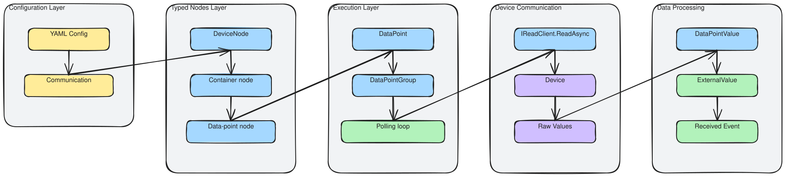
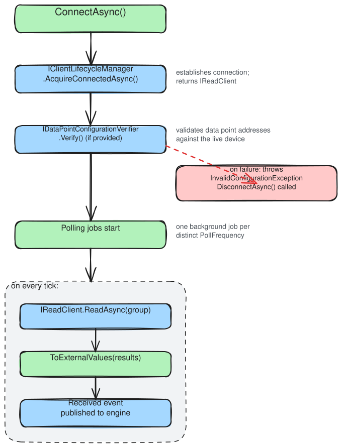
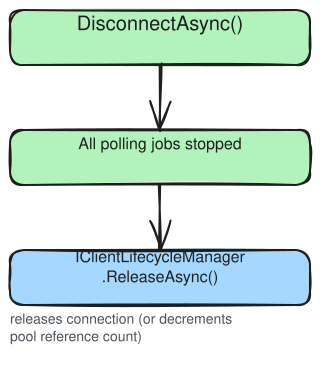

# Incoming Data Port: Design Rationale

`IncomingDataPortBase` polls a device on a schedule and publishes the results as events. This document explains why the polling model is designed the way it is: the decisions made, the tradeoffs involved, and why the responsibilities are divided the way they are.

> **Building an incoming port?** See [Incoming data port](../../how-to/incoming-dataport/incoming-data-port.md) instead.

The diagram below traces the layers a value passes through, from the configured data points down to the published event. The sections that follow take the load-bearing decisions in that flow one at a time.

---

## Polling groups, not polling points

The most visible structural choice in the incoming port is that polling is organised by *group*, not by individual data point.

A simpler design would give each data point its own timer. This fails at scale in two ways. First, timer proliferation: a configuration with 200 data points at three distinct frequencies would create 200 independent background timers competing for thread pool resources. Second, protocol inefficiency: most device protocols batch reads more cheaply than individual reads, and reading 50 MODBUS registers in one transaction costs little more than reading one. One timer per data point makes batching impossible.

Grouping by `PollFrequency` solves both: data points sharing the same frequency get one timer and one `ReadAsync` call. The number of active timers equals the number of distinct frequencies in the configuration, typically two to five, regardless of how many data points exist.

[Polling jobs](polling.md) covers how those per-group timers actually run, including the orchestrator that manages them, the overlapping fire-and-forget execution model, and the start and stop choreography.

---

## Resilience is built in, not optional

Each polling group runs inside a resilience pipeline that wraps every tick with a timeout and circuit breaker. Protocol implementations get this automatically, because the default `DefaultResiliencePipeline` needs no configuration.

This is a deliberate layering decision. Without a shared resilience layer, every new protocol implementation would need to answer the same questions: what happens when a poll hangs? When should repeated failures stop triggering reads? How long before the port tries again? These questions have well-known answers that don't depend on the protocol, so they belong in the base class.

The pipeline is the *default*, not a fixed policy. The base class exposes a single seam, `CreatePollingResiliencePipeline(TDataPointGroup)`, that builds the pipeline for each group. Its default implementation returns `DefaultResiliencePipeline` tuned to the group's poll frequency. An implementation that needs different behaviour overrides this one method, and the default and any override flow through the exact same path, so there is no second code path to reason about. Resilience is never *absent*: the seam always returns a pipeline.

Field deployments run for months. Transient failures such as network blips, device restarts, and brief maintenance windows are expected, not exceptional. A single failed read should not stop a polling group, so the port absorbs it as data rather than a fault: the failure is logged, no `Received` event is raised for that tick, and the next tick proceeds on schedule. Publishing nothing beats publishing half a reading. When failures keep coming, the circuit breaker opens once they accumulate above a threshold, which stops the port hammering a struggling device during a prolonged outage, and it recovers automatically when the device returns.

Polling groups fail independently. A timeout in the 1h group does not affect the 100ms group. This matters when different subsystems of a device have different availability characteristics.

[Polling jobs](polling.md#resilience-is-per-group-and-tuned-to-its-cadence) explains why the timeout and circuit-breaker constants are derived from each group's poll interval rather than fixed, and why each group gets its own breaker state.

---

## Channel mapping is a separate, overridable step

Data points have *channels*, the named streams of data that the ViciOne platform subscribes to. After each `ReadAsync`, a `ToExternalValues` step translates raw read results into `ExternalValue` instances, one per transferred channel.

This step exists because read results and published events have different shapes. A `ReadAsync` call may return a composite value (a register bank, a structure with multiple fields), while the platform expects individual channel values. The mapping step bridges the two.

Making `ToExternalValues` a virtual method, rather than encoding the mapping in the base class, gives protocol implementations full control over how their read results map to channel values without replacing the polling infrastructure. The default implementation handles the common case (one value per channel) so most implementations never override it.

---

## The read path does not range-validate

The write path range-checks every value before it can reach the device. The read path deliberately does not. A reading coming back from the device is authoritative: the device is the source of truth for its own state, so a value that falls outside the declared range is simply what the device reported, not a fault to guard against. Validating it would have nothing to validate it against. The asymmetry is intentional, and the reasoning is set out in full under [why range validation is outgoing-only](../outgoing/outgoing-data-port.md#range-validation-guards-the-device-so-it-runs-only-on-writes).

---

## Lifecycle

Startup and teardown follow the shared sequence described under [Connection lifecycle](../connection/connection-lifecycle.md). What is specific to an incoming port is the polling fleet layered on top of the connection, and the order the two are brought up and down in. `ConnectAsync` acquires the client and verifies configuration *before* a single polling job starts, so a port never polls a connection that has not been checked. `DisconnectAsync` runs the reverse order, stopping every polling job first and only then releasing the client, so no tick is left reading a client that has already gone.

### Connect

### Disconnect

---

## Related explanation

- [Polling jobs](polling.md): the polling subsystem internals, including the orchestrator, periodic job, and resilience-pipeline tuning
- [Overview](../Overview.md): three phases, shared configuration pipeline, and configuration verification
- [Connection lifecycle](../connection/connection-lifecycle.md): when the connection opens and closes, and why the circuit breaker absorbs a failed poll instead of reconnecting
- [Client lifecycle manager](../connection/client-lifecycle-manager.md): why IClientLifecycleManager is separate from IReadClient
- [Outgoing data port](../outgoing/outgoing-data-port.md): the write-side counterpart and where the designs diverge
