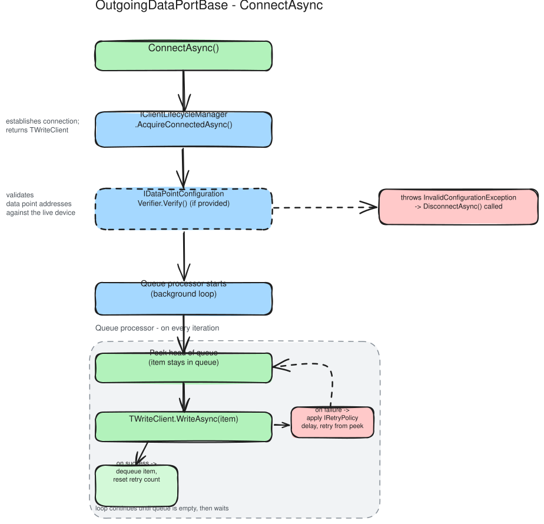
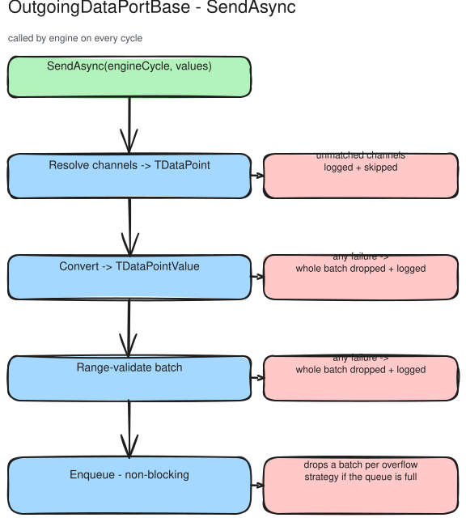
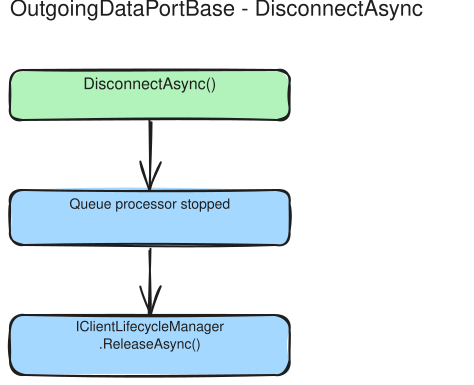

# Outgoing Data Port: Design Rationale

`OutgoingDataPortBase` receives values from the ViciOne engine, resolves them to protocol data points, converts and validates the batch, and writes to a device via a background queue. This document explains why the write path is designed the way it is: the tradeoffs made and why the responsibilities are split where they are.

> **Building an outgoing port?** See [Outgoing data port](../../how-to/outgoing-dataport/outgoing-data-port.md) instead.

---

## A queue, not a direct write

`SendAsync` does not write to the device. It resolves channels, converts values, validates the batch, and enqueues. A background processor does the actual write.

This decoupling exists because device writes are unreliable and can be slow. Network latency, device acknowledgement delays, and transient errors mean a write can take anywhere from microseconds to several seconds, or fail entirely and need retrying. If `SendAsync` blocked until the write completed, the engine cycle that called it would stall for the full duration of every retry.

The queue absorbs the write latency. The engine cycle hands off the data and continues immediately. The queue processor takes responsibility for getting the data to the device, including retrying on failure.

The cost of this design is that write failures are not reported back to `SendAsync` callers. They are logged and retried silently. This is the correct trade for an industrial write path where the caller has no useful recovery action to take on a transient failure, and where freshness is more important than synchronous confirmation.

---

## Channel resolution happens at send time

When `SendAsync` receives `ExternalValue` instances, each carries a channel string. The data port resolves these channel strings to concrete `TDataPoint` objects, the typed structures the write client actually uses.

Resolution happens at send time because the two domains are bridged at different points in time. The data point list is built from YAML configuration at construction. The `ExternalValue` instances arrive at runtime from the engine, carrying only channel strings. Resolving them requires a lookup that connects the two.

The lookup is O(1), a dictionary built once at startup from the data point list. Resolution cost does not scale with the number of data points, which matters because `SendAsync` is called on every engine cycle.

---

## Conversion and range validation are two stages, not one type check

A value travelling toward the device crosses two gates before it can be written. First **conversion**: the engine hands over an untyped `object?`, and the port must turn it into the data point's declared .NET type (can this value be represented as that type at all?). Second **range validation**: the now-typed value is checked against the data point's allowed bounds.

There is deliberately no runtime *type* check between them. A value carried through the queue is an `ITypedDataPointValue<TValue>` whose payload is typed to the data point's declared type at compile time, so it can never hold a value of the wrong .NET type. The only way a value can "have the wrong type" is to have failed conversion in the first place, which is captured as a conversion failure, not deferred to a later validation pass. Folding the type discriminator into the CLR type argument is what removes the whole class of "value and data point disagree about their type" runtime errors.

## Range validation guards the device, so it runs only on writes

Range validation exists for a single purpose: to stop an invalid value from reaching the device, where an out-of-range or wrong-shaped write could corrupt its state. The value it checks is untrusted. It arrives from the engine as an arbitrary `object?`, and nothing upstream guarantees it sits inside the bounds the data point declares, so it is checked before it can be written.

Values read *from* the device are a different matter. The device is the authority on its own state, so a reading that falls outside the declared range is not a fault to defend against; it is simply what the device reported. The incoming path therefore runs no range validation at all, and that absence is a design decision rather than a gap left to be filled.

The same reasoning covers the structural checks: an array's element count, or a string staying within its declared maximum length. On the read path a value's shape is fixed by the read request, and that request is built from the very same data point metadata — element count, maximum length — that validation would compare against. A decoded value cannot disagree with its own data point's declared shape unless the codec has an outright decode bug, and a decode bug is a programming error, best caught by the codec's type-mismatch exceptions and by tests rather than by a validation pass run on every poll.

Two consequences follow, and both are worth stating so the missing check reads as intent. The incoming polling hot path carries no per-value validation cost, and `DataPointValueValidator` lives under the outgoing path and belongs nowhere else. An implementation should resist the urge to "restore symmetry" by validating on read: there is nothing there to catch that a decode test would not catch first.

## Conversion and validation are all-or-nothing

Both gates are all-or-nothing. If any value in a batch fails to convert, or any converted value falls out of range, the entire batch is dropped before any write happens. The drop is silent to the caller: the failure is logged and `SendAsync` still completes normally. It does not throw or otherwise signal the engine cycle that a value was rejected, exactly as for an asynchronous write failure.

The alternative, filtering out the bad values and writing the rest, creates a class of hard-to-detect bugs. Protocol devices often maintain state where multiple values are related. Writing a current setpoint without the accompanying mode flag, or writing half of a coordinated output group, can leave a device in an inconsistent state. The operator sees that the port is running and writing, but the device is behaving unexpectedly.

All-or-nothing is also easier to reason about. Either all the values in an engine cycle reached the device, or none did. Partial success turns debugging into an exercise in guessing which values landed.

> **Note on the asymmetry with unresolved channels.** An `ExternalValue` whose channel matches *no* data point is logged and silently skipped, and the rest of the batch still goes through. A *conversion* or *range* failure, by contrast, drops the whole batch. The two are treated differently on purpose: an unmatched channel is a configuration concern that does not threaten device consistency, whereas a value that reached a real data point but cannot be written safely does.

---

## The peek/mark retry pattern

The queue processor reads the head of the queue without removing it, attempts the write, and only removes the item on success. On failure, the item stays at the head for the next retry attempt.

Re-enqueueing the failed item would be the obvious alternative but has a significant problem: if additional items are waiting, putting a failed item at the back of the queue means later items get written before the earlier one is retried. For state-based devices where write order matters, and most do, since output state is cumulative, this can produce incorrect device state.

Peek/mark preserves queue order under retry. The failed item stays at the head; later items wait behind it. This is the behaviour that leads to backpressure: if the head item cannot be written and the queue fills up, newer items start being dropped. This is the correct consequence: when a device is genuinely unreachable, the oldest pending write should be retried, not discarded in favour of newer data.

The `DropOldest` queue strategy can be used when freshness matters more than order: if the queue fills during retry, the stuck head item is displaced by the newest arrival, trading order guarantees for the assurance that the most recent value eventually gets through.

---

## Backpressure: the queue never blocks the engine

`SendAsync` never blocks and never throws when the queue is full. Blocking would stall the engine cycle that called it, spreading the write failure to every other component the engine is running. Instead the bounded queue applies its overflow strategy, `DropOldest` or `DropNewest`, the moment a batch cannot fit: a batch is dropped, the loss is logged, and the engine cycle continues immediately.

A persistently full queue is the signal that the outgoing port is a bottleneck: the processor is not emptying it as fast as the engine is filling it, almost always because the head item is stuck in retry. The strategies for resolving a chronically full queue are described under [Troubleshooting](../../how-to/outgoing-dataport/outgoing-data-port.md#troubleshooting-write-queue-backpressure) in the how-to guide.

---

## InfiniteRetryPolicy is the default

The default retry policy retries failed writes indefinitely. This is a deliberate choice, not an oversight.

In industrial deployments, devices go offline for maintenance, network reconfiguration, or unplanned outages. The correct response in most of those situations is to keep trying, since the device will come back and the pending write should eventually reach it. Giving up and dropping the data means the device state diverges from the intended state. In a control system, a delayed write is far preferable to a silent drop.

`BoundedRetryPolicy` is the override for cases where eventually giving up is correct, typically when writes are informational (telemetry, audit logs) and the receiver doesn't maintain persistent state that must be kept in sync.

This is a system-level decision that depends on the protocol and the deployment context. The library cannot make it on behalf of the implementer, so it exposes `RetryPolicy` as an explicit override point rather than encoding a policy in the base class.

---

## Why the write path does not use Polly

The incoming path runs every poll through a Polly `ResiliencePipeline`. The write path does not. It uses a hand-written retry loop in `QueueProcessor` built on `IRetryPolicy` and `RetryBackoffCalculator`, and that difference is deliberate.

Polly is perfectly capable of most of what the loop does. Unbounded retries are `MaxRetryAttempts = int.MaxValue`, exponential backoff with jitter is `DelayBackoffType.Exponential` plus `UseJitter`, the progressive log throttling fits an `OnRetry` callback, and `TimeProvider` covers the same test seam as `IDelayProvider`. On capability alone there is no gap.

What does not fit is the backpressure check. After each backoff the loop asks whether the item it is retrying is still at the head of the queue, and if a `DropOldest` overflow has displaced it, abandons the retry entirely rather than writing stale data. Polly decides whether to retry from the *outcome* of the attempt, the exception or result that `ShouldHandle` inspects. It has no notion of external state that changed while the strategy was waiting. Expressing the check in Polly means either throwing out of `OnRetry`, a hook documented for side effects, or smuggling a state read into a `DelayGenerator`. Both work. Both leave a reader needing to know that an exception thrown from `OnRetry` propagates out of the pipeline before they can follow the control flow at all.

There is a second, smaller friction. `WriteAsync` is called with `CancellationToken.None` on purpose, so that a disconnect never severs a write in flight, while the backoff delay observes the real token and lets shutdown interrupt the wait. Polly threads one `ResilienceContext` token through both the callback and its own delays, so the write callback would have to ignore the token it is handed.

Against that, the payoff would have been thirty-odd lines of backoff arithmetic and a retry counter. The incoming path went the other way because it fits cleanly: a timeout and a circuit breaker wrapped around a self-contained read, with no queue state consulted between attempts, which is the shape Polly is built for.

---

## Lifecycle

### Connect

### SendAsync

### Disconnect

---

## Related explanation

- [Overview](../Overview.md): three phases, shared configuration pipeline, and configuration verification
- [Connection lifecycle](../connection/connection-lifecycle.md): when the connection opens and closes, and why a stuck write retries in place instead of reconnecting
- [Client lifecycle manager](../connection/client-lifecycle-manager.md): why TWriteClient doubles as the connection handle
- [Incoming data port](../incoming/incoming-data-port.md): the read-side counterpart and where the designs diverge
