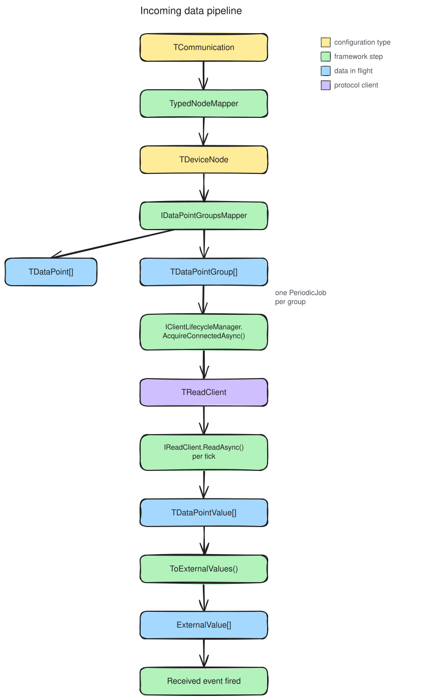

# Build an incoming data port

**Namespace**: `ViciOne.Suite.DataPort.Extensions.Incoming`

An incoming data port reads a device on a schedule and publishes what it gets as `ExternalValue`
events. You build it by subclassing `IncomingDataPortBase`, which handles the whole
connect → verify → poll → publish lifecycle; you supply the protocol-specific pieces. For *why* the
polling model works the way it does, see the
[design rationale](../../explanation/incoming/incoming-data-port.md).



## Before you start

Build the [shared building blocks](../index.md#shared-building-blocks) first — they are the same for
both directions:

1. [Define the configuration schema](../shared/configuration-schema.md)
2. [Model the configuration as typed nodes](../shared/node-model.md)
3. [Define the runtime data points](../shared/data-points.md) — use `IPollingDataPoint`, so points
   can be grouped by poll frequency
4. [Manage the connection](../shared/connection.md)

The incoming-specific steps below add a read client, a groups mapper, and the subclass. The complete
worked example is `tests/DataPort.Extensions.Tests/Stubs/Incoming/TestIncomingDataPort.cs` and the
types it references.

## The generic parameters

`IncomingDataPortBase` takes seven type parameters. Most are the shared building blocks you already
built; the last three are the incoming-specific pieces from this guide:

| Parameter | Your type (example) | Built in |
|-----------|---------------------|----------|
| `TCommunication` | `TestCommunication` | [Node model](../shared/node-model.md#1-define-the-communication-type) |
| `TDeviceNode` | `TestDeviceNode` | [Node model](../shared/node-model.md#2-define-the-root-node-and-its-mapper) |
| `TDataPoint` | `TestDataPoint` (an `IPollingDataPoint`) | [Data points](../shared/data-points.md) |
| `TDataPointGroup` | `TestDataPointGroup` | step 2 below |
| `TDataPointValue` | `IDataPointValue` | [Data points](../shared/data-points.md) |
| `TReadClient` | `TestClient` | step 1 below |
| `TClientInformation` | `TestClientInformation` | [Connection](../shared/connection.md) |

## 1. Implement the read client

The read client is what actually talks to the device. It implements
`IReadClient<TDataPointGroup, TDataPointValue>` — one method, `ReadAsync`, that reads every data point
in a group in a single call and returns the values. Reading by group (not by point) is what lets you
exploit the cheap batch reads most protocols offer.

The example's `TestClient` (`Stubs/Client/TestClient.cs`) implements both client interfaces; the
read half is:

```csharp
public ValueTask<IReadOnlyList<IDataPointValue>> ReadAsync(
    TestDataPointGroup dataPointGroup, CancellationToken cancellationToken)
{
    // read all data points in the group from the device,
    // build one ITypedDataPointValue per result (via dataPoint.CreateTypedValue(...)),
    // and throw ConnectionFailureException or DataRetrievalException on failure
}
```

The client is the object your [lifecycle manager](../shared/connection.md#2-implement-the-lifecycle-manager)
returns from `AcquireConnectedAsync`.

## 2. Map and group the data points

The groups mapper flattens the [typed node tree](../shared/node-model.md) into data points, then
groups them by poll frequency — one polling job runs per group. Implement
`IDataPointGroupsMapper<TDataPoint, TDataPointGroup, TDeviceNode, TCommunication>`. You provide
`ToDataPoints` (walk the tree, emit one point per addressable node) and `CreateGroup`; the interface's
default `Group`/`ToDataPointGroups` partition the points by `PollFrequency` for you.

`Stubs/Model/Mapping/TestDataPointGroupsMapper.cs`:

```csharp
internal sealed class TestDataPointGroupsMapper
    : IDataPointGroupsMapper<TestDataPoint, TestDataPointGroup, TestDeviceNode, TestCommunication>
{
    public IReadOnlyList<TestDataPoint> ToDataPoints(TestDeviceNode deviceNode) =>
        [.. deviceNode.DataPointNodes.Select(MapToDataPoint).OfType<TestDataPoint>()];

    public TestDataPointGroup CreateGroup(PollFrequency pollFrequency, IReadOnlyList<TestDataPoint> dataPoints)
        => new() { DataPoints = dataPoints, PollFrequency = pollFrequency };

    // map each node type to its matching strongly-typed data point; unknown node types are ignored
    private static TestDataPoint? MapToDataPoint(IDataPointNode node) => node switch
    {
        IntNode i    => new IntDataPoint    { Channels = i.Channels, PollFrequency = i.PollFrequency },
        StringNode s => new StringDataPoint { Channels = s.Channels, PollFrequency = s.PollFrequency },
        _ => null
    };
}
```

The group type itself is a small record implementing `IDataPointPollingGroup<TDataPoint>`
(`Stubs/Model/DataPort/TestDataPointGroup.cs`) — a list of points plus their shared `PollFrequency`.

## 3. Subclass `IncomingDataPortBase`

Fill the generic parameters and implement the two required members: `ClientInformation` (which device
to connect to) and `ClientLifecycleManager` (how to acquire the read client). Everything else has a
working default.

`Stubs/Incoming/TestIncomingDataPort.cs`:

```csharp
internal class TestIncomingDataPort(
    TestCommunication communication,
    ILoggerFactory loggerFactory,
    TypedNodeMapper<TestCommunication, TestDeviceNode> typedNodeMapper,
    TestDataPointGroupsMapper dataPointGroupsMapper,
    IClientLifecycleManager<TestClient, TestClientInformation> connectionManager,
    TimeProvider? timeProvider = null)
    : IncomingDataPortBase<TestCommunication, TestDeviceNode, TestDataPoint, TestDataPointGroup,
        IDataPointValue, TestClient, TestClientInformation>(
        communication, loggerFactory, typedNodeMapper, dataPointGroupsMapper, timeProvider)
{
    protected override IClientLifecycleManager<TestClient, TestClientInformation> ClientLifecycleManager { get; }
        = connectionManager;

    public override TestClientInformation ClientInformation { get; } = new();
}
```

The `typedNodeMapper` and `dataPointGroupsMapper` run at construction, so a bad configuration fails
here, before any connection. The optional `timeProvider` exists for [testing](#test-the-polling-loop);
leave it `null` in production to use the system clock.

## 4. (Optional) Customize value publishing

After each read, the base class converts the values to `ExternalValue`s and raises `Received`. The
**built-in default** emits one `ExternalValue` per transferred channel on each data point, with
`Validity = 1` and the value used as-is. Override `ToExternalValues` only when you need different
channel mapping or value transformation; override the finer-grained
`ToExternalValue(timestamp, channel, value)` to change a single channel's mapping without rewriting
the loop.

This runs on every poll, so keep it allocation-light — pre-size the result list and use indexed loops
rather than LINQ:

```csharp
protected override IReadOnlyList<ExternalValue> ToExternalValues(IReadOnlyList<IDataPointValue> values, DateTime timestamp)
{
    var result = new List<ExternalValue>(values.Sum(v => v.DataPoint.Channels.Transferred.Count));
    for (var i = 0; i < values.Count; i++)
        foreach (var channel in values[i].DataPoint.Channels.Transferred)
            result.Add(new ExternalValue { Channel = channel.Value, Value = values[i].Value, Timestamp = timestamp, Validity = 1 });
    return result;
}
```

## 5. (Optional) Customize polling resilience

Every polling group runs inside a Polly resilience pipeline. The default,
`DefaultResiliencePipeline`, wraps each read in a timeout plus a circuit breaker tuned to the group's
poll frequency — one failed read never stops a group, and each group's breaker is independent.
Override `CreatePollingResiliencePipeline(TDataPointGroup)` to replace it; the base class calls the
method once per group, so you can tune per group or return one shared pipeline (whose breaker state is
then shared):

```csharp
protected override ResiliencePipeline<IReadOnlyList<IDataPointValue>> CreatePollingResiliencePipeline(TestDataPointGroup group)
    => group.PollFrequency < TimeSpan.FromSeconds(1) ? _fastPipeline : _slowPipeline;
```

For the default's exact settings (all derived from the group's poll interval), see
[Resilience](../../reference/resilience.md#defaultresiliencepipeline); for *why* they scale with the
interval and the per-group execution model, see [Polling jobs](../../explanation/incoming/polling.md).

## 6. (Optional) Verify configuration on connect

Override `CreateConfigurationVerifier(TestClient client)` to check the configured addresses against
the live device before polling starts. See
[Verify configuration on connect](../shared/configuration-verification.md).

## Use the port

Subscribe to `Received` **before** calling `ConnectAsync`, or you'll miss the first poll's events:

```csharp
dataPort.Received += values => /* handle the ExternalValues */;
await dataPort.ConnectAsync(cancellationToken);
```

`ConnectAsync` acquires the client, runs the optional verifier, and starts one polling job per group.
`DisconnectAsync` stops polling and releases the client but keeps the port reusable; `DisposeAsync` is
terminal. For the full lifecycle, see the
[design rationale](../../explanation/incoming/incoming-data-port.md#lifecycle).

## Test the polling loop

Pass a `FakeTimeProvider` (from `Microsoft.Extensions.TimeProvider.Testing`) as `timeProvider` to
trigger polls deterministically instead of waiting for real intervals. Advancing the clock fires the
tick; the job body still runs on a background thread, so assert on the outcome eventually rather than
immediately. This is exactly what
`tests/DataPort.Extensions.Tests/Incoming/IncomingDataPortBaseTests.cs` does:

```csharp
var timeProvider = new FakeTimeProvider();
var dataPort = new TestIncomingDataPort(/* … */, timeProvider: timeProvider);

IReadOnlyCollection<ExternalValue>? received = null;
dataPort.Received += values => received = values;

await dataPort.ConnectAsync(CancellationToken.None);

timeProvider.Advance(TimeSpan.FromMilliseconds(150)); // past the poll interval → one tick
await Task.Delay(100);                                // let the background job run

received.Should().NotBeNull();
```

The `DataPort.Extensions.Testing` package also offers an `Eventually(() => …).Should()…` polling
assertion for this pattern — see
[DataPort.Extensions.Testing](../../../DataPort.Extensions.Testing/index.md).

## Related

- [Incoming data port — design rationale](../../explanation/incoming/incoming-data-port.md) ·
  [Polling jobs](../../explanation/incoming/polling.md)
- [Interfaces reference](../../reference/interfaces.md#read-operations) — `IReadClient`,
  `IDataPointGroupsMapper`
- [Build an outgoing data port](../outgoing-dataport/outgoing-data-port.md) — the write direction
