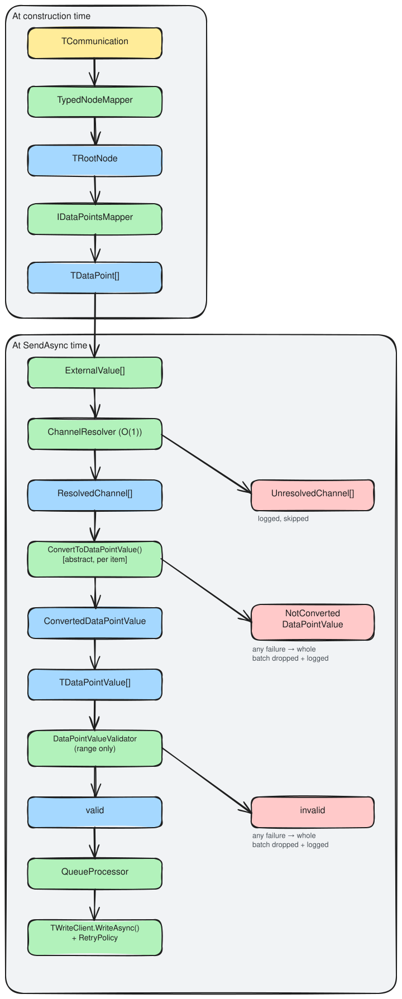

# Build an outgoing data port

**Namespace**: `ViciOne.Suite.DataPort.Extensions.Outgoing`

An outgoing data port takes values from the engine and writes them to the device — never directly,
always through a background queue. You build it by subclassing `OutgoingDataPortBase`, which handles
the connect → resolve → convert → validate → enqueue → write-with-retry pipeline; you supply the
protocol-specific pieces. For *why* the queue-based model works the way it does, see the
[design rationale](../../explanation/outgoing/outgoing-data-port.md).



The write path has **two all-or-nothing gates**. Conversion asks *can this untyped value be
represented as the data point's declared .NET type?*; range validation asks *is the typed value within
bounds?*. A failure at either gate drops the whole batch. There is no separate runtime type check —
type correctness is guaranteed by the [strongly-typed value](../shared/data-points.md#make-the-type-the-values-type).
See [Value conversion and validation](../../reference/value-validation.md).

## Before you start

Build the [shared building blocks](../index.md#shared-building-blocks) first — they are the same for
both directions:

1. [Define the configuration schema](../shared/configuration-schema.md)
2. [Model the configuration as typed nodes](../shared/node-model.md)
3. [Define the runtime data points](../shared/data-points.md)
4. [Manage the connection](../shared/connection.md)

The outgoing-specific steps below add a write client, a data-points mapper, and the subclass with its
value-conversion method. The complete worked example is
`tests/DataPort.Extensions.Tests/Stubs/Outgoing/TestOutgoingDataPort.cs` and the types it references.

## The generic parameters

`OutgoingDataPortBase` takes six type parameters — the shared building blocks plus the write client:

| Parameter | Your type (example) | Built in |
|-----------|---------------------|----------|
| `TDataPoint` | `TestDataPoint` (an `IDataPoint`) | [Data points](../shared/data-points.md) |
| `TDataPointValue` | `IDataPointValue` | [Data points](../shared/data-points.md) |
| `TWriteClient` | `TestClient` | step 1 below |
| `TRootNode` | `TestDeviceNode` | [Node model](../shared/node-model.md#2-define-the-root-node-and-its-mapper) |
| `TCommunication` | `TestCommunication` | [Node model](../shared/node-model.md#1-define-the-communication-type) |
| `TClientInformation` | `TestClientInformation` | [Connection](../shared/connection.md) |

> **`TWriteClient` plays a dual role**: it is both the client returned by
> [`AcquireConnectedAsync`](../shared/connection.md#2-implement-the-lifecycle-manager) and the object
> you write through (it implements `IWriteClient<TDataPointValue>`). There is no separate write-client
> property.

## 1. Implement the write client

The write client implements `IWriteClient<TDataPointValue>` — one method, `WriteAsync`, that writes a
batch of values to the device in a single call where possible. Throw on any failure; the base class
handles retry.

The example's `TestClient` (`Stubs/Client/TestClient.cs`) implements both client interfaces; the
write half is:

```csharp
public ValueTask WriteAsync(IReadOnlyList<IDataPointValue> values, CancellationToken cancellationToken)
{
    // write all values to the device in one call where the protocol allows;
    // throw on failure — OutgoingDataPortBase retries per its RetryPolicy
}
```

Because the write client *is* the connection handle, it is also what your
[lifecycle manager](../shared/connection.md#2-implement-the-lifecycle-manager) returns.

## 2. Map the data points

The outgoing port needs a flat list of data points, with no grouping. Implement
`IDataPointsMapper<TRootNode, TCommunication, TDataPoint>` — just `ToDataPoints`, which walks the
[typed node tree](../shared/node-model.md) and emits one point per writable address. The base class
indexes them by channel for O(1) resolution at send time.

`IDataPointGroupsMapper` (the incoming mapper) *extends* `IDataPointsMapper`, so a single mapper can
serve both directions. The example reuses its `TestDataPointGroupsMapper`
([shown in the incoming guide](../incoming-dataport/incoming-data-port.md#2-map-and-group-the-data-points))
for the outgoing port — the grouping half is simply ignored here.

## 3. Subclass `OutgoingDataPortBase`

Fill the generic parameters and implement three required members: `ClientInformation`,
`ClientLifecycleManager`, and `ConvertToDataPointValue`.

`Stubs/Outgoing/TestOutgoingDataPort.cs`:

```csharp
internal class TestOutgoingDataPort(
    TestCommunication communication,
    TypedNodeMapper<TestCommunication, TestDeviceNode> typedNodeMapper,
    IDataPointsMapper<TestDeviceNode, TestCommunication, TestDataPoint> mapper,
    QueueConfiguration queueConfiguration,
    IClientLifecycleManager<TestClient, TestClientInformation> connectionManager,
    ILoggerFactory loggerFactory,
    IDelayProvider? delayProvider = null)
    : OutgoingDataPortBase<TestDataPoint, IDataPointValue, TestClient, TestDeviceNode, TestCommunication,
        TestClientInformation>(
        communication, loggerFactory, typedNodeMapper, mapper, queueConfiguration,
        delayProvider ?? new DefaultDelayProvider())
{
    protected override IClientLifecycleManager<TestClient, TestClientInformation> ClientLifecycleManager { get; }
        = connectionManager;

    public override TestClientInformation ClientInformation { get; } = new();

    protected override DataPointValueConversion<IDataPointValue> ConvertToDataPointValue(
        ExternalValue externalValue, TestDataPoint dataPoint)
        => dataPoint.ConvertValue(externalValue.Value);
}
```

`ConvertToDataPointValue` is the first gate. It turns an `ExternalValue` already matched to a data
point into a typed write value, or returns a `NotConvertedDataPointValue` describing why it couldn't.
Returning the failure (rather than throwing or returning null) lets the base class log it and drop the
batch cleanly. The example delegates to the data point's own
[`ConvertValue`](../shared/data-points.md#the-two-methods-that-do-the-work); range validation (the
second gate) then runs automatically via each value's `IsInValueRange()`.

The `queueConfiguration` (capacity and overflow strategy) and `delayProvider` (retry backoff timing)
are constructor inputs — use `DefaultDelayProvider` in production and `InstantDelayProvider` in tests.

## 4. (Optional) Tune retry and queue behavior

Two behaviors ship with sensible defaults; override them when your deployment needs something else:

- **`RetryPolicy`** defaults to `InfiniteRetryPolicy` — failed writes retry forever with exponential
  backoff, which is usually right for a state-based device that will eventually come back. Override
  with `BoundedRetryPolicy` for informational writes whose receiver keeps no state to stay in sync:

  ```csharp
  protected override IRetryPolicy RetryPolicy { get; } = new BoundedRetryPolicy(maxRetryAttempts: 5);
  ```

- **`QueueConfiguration`** (a constructor argument) sets the queue's `QueueSize` and overflow
  `QueueStrategy` — `DropOldest` to prioritise freshness, `DropNewest` to preserve order. `SendAsync`
  never blocks or throws when the queue is full; it falls back to this strategy so a stuck write can't
  stall the engine cycle.

For the retry backoff formula, the peek/mark retry pattern, and backpressure handling, see
[Resilience](../../reference/resilience.md) and the
[design rationale](../../explanation/outgoing/outgoing-data-port.md).

## 5. (Optional) Verify configuration on connect

Override `CreateConfigurationVerifier(TestClient client)` to check the configured addresses against
the live device before the queue processor starts — worth doing even for a write-only port, so a bad
address fails at startup instead of as a silent write failure. See
[Verify configuration on connect](../shared/configuration-verification.md).

## Use the port

Call `ConnectAsync` before sending; it acquires the client, runs the optional verifier, and starts the
background queue processor. `SendAsync` resolves channels, converts and range-checks the batch, and
enqueues — it returns immediately, and a write failure is logged and retried rather than surfaced to
the caller:

```csharp
await dataPort.ConnectAsync(cancellationToken);
await dataPort.SendAsync(engineCycle, externalValues, cancellationToken);
```

`DisconnectAsync` stops the processor and releases the client but keeps the port reusable;
`DisposeAsync` is terminal. For the full lifecycle, see the
[design rationale](../../explanation/outgoing/outgoing-data-port.md#lifecycle).

## Troubleshooting: write queue backpressure

**Symptoms**: `QueueBackpressureException` in logs; "Abandoning retry due to backpressure"; writes
silently dropped.

**Cause**: writes arrive faster than the device accepts them — a slow device, network congestion, or
`InfiniteRetryPolicy` blocking the processor on a failing write while the queue fills.

**Fixes**: batch more values per `SendAsync` or rate-limit at the source; switch to `BoundedRetryPolicy`
so a stuck write eventually unblocks the processor; raise `QueueSize` to absorb bursts; or use
`DropOldest` so fresh data still gets through. A persistently full queue is itself the signal that the
port has become a bottleneck — almost always because the head item is stuck in retry.

## Test the write path

Inject `InstantDelayProvider` so retries don't actually wait, and a stub client whose `WriteAsync`
fails a set number of times before succeeding — then assert on the call count. This is the pattern in
`tests/DataPort.Extensions.Tests/Outgoing/OutgoingDataPortBaseTests.cs`. The
`DataPort.Extensions.Testing` package provides an `Eventually(() => …).Should()…` assertion for the
asynchronous outcome — see
[DataPort.Extensions.Testing](../../../DataPort.Extensions.Testing/index.md).

## Related

- [Outgoing data port — design rationale](../../explanation/outgoing/outgoing-data-port.md)
- [Value conversion and validation](../../reference/value-validation.md) — the two gates in detail
- [Interfaces reference](../../reference/interfaces.md#write-operations) — `IWriteClient`,
  `IDataPointsMapper` · [Queue](../../reference/queue.md) · [Resilience](../../reference/resilience.md)
- [Build an incoming data port](../incoming-dataport/incoming-data-port.md) — the read direction
