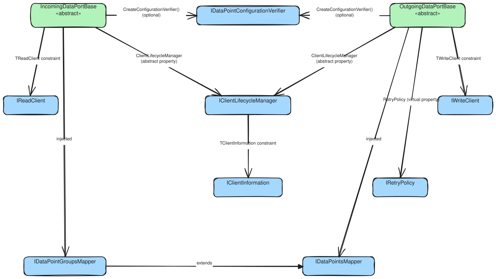

# DataPort Extensions Interfaces

**Root namespace**: `ViciOne.Suite.DataPort.Extensions`

> **Beyond the API summaries.** The generated [API reference](api/index.md) carries each contract's
> signatures, type parameters, and members. This page adds the *map*: it groups the contracts by the
> role they play in a data port, shows how they relate, and points to the *why* (explanation) and the
> *how* (how-to).

---

## Connection Management

### [IClientInformation](xref:ViciOne.Suite.DataPort.Extensions.Client.IClientInformation)

The `TClientInformation` type parameter of both base classes.

### [IClientLifecycleManager\<TClient, TClientInformation\>](xref:ViciOne.Suite.DataPort.Extensions.Client.IClientLifecycleManager%602)

Shared by `IncomingDataPortBase` and `OutgoingDataPortBase`; supplied through the
`ClientLifecycleManager` property rather than constructor injection.

→ Why it is a separate concern, and the pool-adapter and threading patterns:
[Client lifecycle manager](../explanation/connection/client-lifecycle-manager.md) ·
When acquire/release run across the connection's lifetime:
[Connection lifecycle](../explanation/connection/connection-lifecycle.md) ·
Wiring: [Manage the connection](../how-to/shared/connection.md#2-implement-the-lifecycle-manager)

---

## Read Operations

### [IReadClient\<TDataPointGroup, TDataPointValue\>](xref:ViciOne.Suite.DataPort.Extensions.Incoming.Client.IReadClient%602)

Implemented by the `TReadClient` that `IClientLifecycleManager.AcquireConnectedAsync` returns for an
incoming port.

→ Wiring and error translation:
[incoming how-to](../how-to/incoming-dataport/incoming-data-port.md#1-implement-the-read-client)

---

## Write Operations

### [IWriteClient\<TDataPointValue\>](xref:ViciOne.Suite.DataPort.Extensions.Outgoing.Client.IWriteClient%601)

Implemented by the `TWriteClient` that `IClientLifecycleManager.AcquireConnectedAsync` returns for an
outgoing port — for outgoing ports the connection handle and the write client are the same object.

→ Why they coincide: [Client lifecycle manager](../explanation/connection/client-lifecycle-manager.md#outgoing-the-write-client-doubles-as-the-connection-handle) ·
Wiring: [outgoing how-to](../how-to/outgoing-dataport/outgoing-data-port.md#1-implement-the-write-client)

---

## Configuration Verification

### [IDataPointConfigurationVerifier\<TDataPoint\>](xref:ViciOne.Suite.DataPort.Extensions.Verification.IDataPointConfigurationVerifier%601)

Optional; supplied through the `CreateConfigurationVerifier(client)` factory. Its contract — return
failures rather than throwing — is on the generated API page.

→ Why verification is opt-in: [Configuration verification](../explanation/connection/configuration-verification.md)

---

## Mapping Interfaces

**Namespace**: `ViciOne.Suite.DataPort.Extensions.Model.Mapping`

### [IDataPointsMapper\<TRootNode, TCommunication, TDataPoint\>](xref:ViciOne.Suite.DataPort.Extensions.Model.Mapping.IDataPointsMapper%603)

Used by outgoing ports.

### [IDataPointGroupsMapper\<TDataPoint, TDataPointGroup, TRootNode, TCommunication\>](xref:ViciOne.Suite.DataPort.Extensions.Model.Mapping.IDataPointGroupsMapper%604)

Used by incoming ports; extends `IDataPointsMapper`.

→ How the two relate and why they are split:
[Internal data model](../explanation/configuration/internal-data-model.md#idatapointsmapper-and-idatapointgroupsmapper-as-the-bridge)

---

## Data point interfaces

The data point and value contracts (`IDataPoint`, `ITypedDataPoint<TValue>`, `IPollingDataPoint`,
`IDataPointValue`, `ITypedDataPointValue<TValue>`) live with the rest of the runtime model in
[Model](model.md#data-point-abstractions).

---

## Interface Relationships

