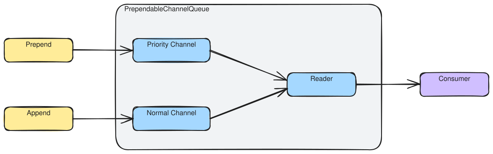

# Queue Components

**Namespace**: `ViciOne.Suite.DataPort.Extensions.Outgoing.QueueProcessing`

> **Beyond the API summaries.** The generated [API reference](api/index.md) carries each type's members
> and overflow behaviour. This page adds how the bounded write-queue building blocks fit together for an
> outgoing port, and points to the *why* — why the write path queues at all, the peek/mark retry pattern,
> and backpressure — in [Outgoing data port](../explanation/outgoing/outgoing-data-port.md).

## Components

### [ChannelQueue\<T\>](xref:ViciOne.Suite.DataPort.Extensions.Outgoing.QueueProcessing.Bounded.ChannelQueue%601)

The append-only (FIFO) write buffer; base of `PrependableChannelQueue<T>`.

### [PrependableChannelQueue\<T\>](xref:ViciOne.Suite.DataPort.Extensions.Outgoing.QueueProcessing.Prependable.PrependableChannelQueue%601)

Adds `Prepend` to the `ChannelQueue<T>` surface, so a failed write can be re-queued ahead of newer ones.

### [QueueConfiguration](xref:ViciOne.Suite.DataPort.Extensions.Outgoing.QueueProcessing.QueueConfiguration)

The required constructor parameter of `OutgoingDataPortBase`, bundling a
[`QueueStrategy`](xref:ViciOne.Suite.DataPort.Extensions.Outgoing.QueueProcessing.QueueStrategy) and a
[`QueueSize`](xref:ViciOne.Suite.DataPort.Extensions.Outgoing.QueueProcessing.QueueSize).

→ Choosing a capacity and overflow strategy, and recovering a chronically full queue:
[Outgoing how-to — Troubleshooting](../how-to/outgoing-dataport/outgoing-data-port.md#troubleshooting-write-queue-backpressure)
